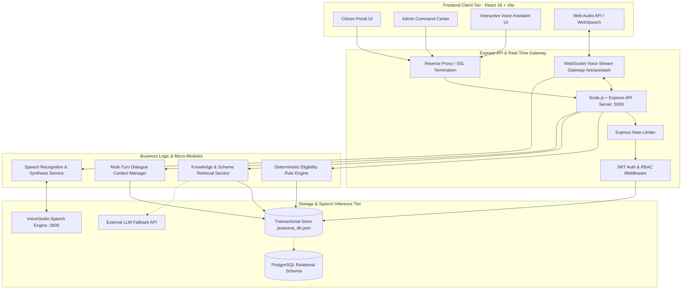

# JANASEVA – End-to-End System Architecture Specification

> **Document Version:** 2.0.0 (Production)  
> **Status:** Active / Production Specification  
> **Repository:** [Jana-Seva](https://github.com/Sachinxcode-01/jana-seva.git)

---

## 1. System Topology & Architectural Overview

JANASEVA is engineered as a decoupled, multi-tier civic technology platform consisting of a responsive Single Page Application (SPA), a modular Node.js/Express REST and WebSocket API gateway, a deterministic multi-variable rule evaluation engine, and a conversational AI voice assistant with local and browser-fallback speech capabilities.



---

## 2. Frontend Architecture (Client Tier)

The frontend is built with **React 18**, **TypeScript**, and **Vite**, prioritizing low-latency rendering, WCAG 2.1 AA accessibility, and native trilingual capability.

### 2.1 Directory Structure & Organization
```
frontend/src/
├── assets/             # Logos, emblems, static icons
├── components/         # Reusable UI component library
│   ├── Navbar.tsx      # Responsive header with language & role toggle
│   ├── Footer.tsx      # Civic links, statutory disclaimers, helplines
│   ├── SchemeCard.tsx  # Scheme cards with match badges and bookmarking
│   ├── ComparisonTable.tsx # Side-by-side comparative matrix
│   ├── VoiceModal.tsx  # Speech recording visualizer and transcript
│   └── StatCard.tsx    # Admin KPI dashboard summary cards
├── context/            # React Context state containers
│   ├── AuthContext.tsx # User session, token storage, login/logout
│   └── LanguageContext.tsx # i18n locale state (en, kn, hi)
├── pages/              # Top-level view routing components
│   ├── HomePage.tsx    # Hero section, featured schemes, quick access
│   ├── DirectoryPage.tsx # Scheme repository with multi-facet filters
│   ├── SchemeDetailsPage.tsx # Deep-dive criteria, documents, official link
│   ├── EligibilityCheckerPage.tsx # 3-Step interactive eligibility wizard
│   ├── ComparePage.tsx # Side-by-side scheme comparison matrix
│   ├── CitizenApplicationsPage.tsx # Citizen personal application ledger
│   ├── MyDocumentsPage.tsx # Document vault checklist
│   └── AdminPage.tsx   # Recharts analytics, Scheme CRUD, audit logs
├── services/           # Decoupled HTTP API clients
│   ├── api.ts          # Axios base client with auth interceptor
│   ├── schemeService.ts# Scheme catalog queries and search
│   ├── eligibilityService.ts # Wizard payload submission
│   └── adminService.ts # Scheme mutation and audit logs
├── types/              # Shared TypeScript data contracts
└── App.tsx             # Route declaration and top-level layout
```

### 2.2 Global State Management
Instead of introducing heavy external state management libraries, JANASEVA utilizes idiomatic **React Context**:
- **`AuthContext`:** Stores authenticated user profile `{ id, email, name, role, token }`, manages local storage token persistence, and injects Authorization headers via API interceptors.
- **`LanguageContext`:** Controls active locale (`en`, `kn`, `hi`), exposes dictionary lookup helpers, and syncs HTML `lang` attributes.

### 2.3 Data Visualization (Recharts)
Administrative insights are rendered using responsive SVGs via **Recharts**:
- `CategoryDistribution`: BarChart illustrating scheme volume per demographic.
- `CentralVsState`: Donut / PieChart displaying the proportion of Union vs. Karnataka State initiatives.
- `TrafficInsights`: AreaChart tracking view counts across welfare schemes.

---

## 3. Backend Architecture (Application Tier)

The backend runs on **Node.js** with **Express.js** and **TypeScript**, structured using a modular service-oriented architecture.

### 3.1 Modular Request Flow
```
Client Request
      │
      ▼
1. Helmet & Security Headers
      │
      ▼
2. CORS Whitelist Validator
      │
      ▼
3. Rate Limiting Middleware (/api/auth, /api/assistant)
      │
      ▼
4. Express Body Parser (JSON, urlencoded)
      │
      ▼
5. Route Matcher (/api/schemes, /api/eligibility, etc.)
      │
      ▼
6. Authentication & RBAC Middleware (requireAuth, requireAdmin)
      │
      ▼
7. Controller / Service Execution
      │
      ▼
8. Transactional Database Read / Atomic Write
      │
      ▼
Client Response (JSON)
```

### 3.2 Backend Module Breakdown
```
backend/src/
├── auth/               # JWT token creation and verification middleware
├── database/           # Persistence abstraction layer
│   ├── db.ts           # Atomic JSON store (janaseva_db.json) with SQLite/Postgres compatibility
│   └── schema.sql      # Enterprise PostgreSQL relational schema
├── modules/            # Decoupled AI and Voice micro-services
│   ├── assistant/      # Dialog context and assistant controllers
│   ├── knowledge/      # Scheme search and source grounding services
│   └── voice/          # VoiceStudio HTTP client and WebSocket gateway
├── routes/             # REST API endpoint definitions
│   ├── authRoutes.ts   # Registration, login, demo accounts
│   ├── schemeRoutes.ts # Public scheme directory and single scheme retrieval
│   ├── eligibilityRoutes.ts # 3-step criteria evaluation endpoint
│   ├── userRoutes.ts   # Bookmarks, applications, documents
│   ├── adminRoutes.ts  # Administrative CRUD and analytics stats
│   └── assistantRoutes.ts # Chat completions and voice transcriptions
├── services/           # Core domain logic
│   └── eligibilityEngine.ts # Deterministic matching algorithm
├── server.ts           # Server bootstrap and WebSocket attachment
└── types.ts            # Canonical data models
```

---

## 4. Deterministic Eligibility Engine

The eligibility engine (`backend/src/services/eligibilityEngine.ts`) evaluates citizen demographics against scheme parameters deterministically, avoiding black-box errors.

### 4.1 Evaluation Algorithm & Mathematical Model
For a given applicant profile $P = \{ age, gender, state, occupation, category, income \}$ and scheme criteria $C$:

1. **Hard Constraint Gates (Multiplicative Filters):**
   - **Gender Gate:**  
     $$G_{gender} = \begin{cases} 1 & \text{if } C.gender = \text{'All'} \lor C.gender = P.gender \\ 0 & \text{otherwise} \end{cases}$$
   - **State Domicile Gate:**  
     $$G_{state} = \begin{cases} 1 & \text{if } C.level = \text{'Central'} \lor P.state = \text{'Karnataka'} \\ 0 & \text{otherwise} \end{cases}$$
   - If $G_{gender} \times G_{state} = 0$, the Final Match Score is immediately assigned **$0\%$**, and unmet conditions are documented.

2. **Weighted Score Computation (When Gates Pass):**
   - **Age Criterion ($W_{age} = 25$):**  
     Passes if $C.minAge \le P.age \le C.maxAge$.
   - **Income Criterion ($W_{income} = 35$):**  
     Passes if $P.income \le C.incomeLimit$. Partial score ($15$) awarded if within $15\%$ of limit.
   - **Occupation Alignment ($W_{occ} = 25$):**  
     Passes if $C.targetBeneficiaries$ matches $P.occupation$.
   - **Category Match ($W_{cat} = 15$):**  
     Passes if $C.targetBeneficiaries$ matches $P.category$ or includes `All`.

3. **Final Formula:**  
   $$\text{MatchScore} = G_{gender} \times G_{state} \times \left( S_{age} + S_{income} + S_{occ} + S_{cat} \right)$$

---

## 5. Conversational Voice & AI Assistant Architecture

The voice architecture provides an accessible multimodal conversational interface for rural citizens:

```
[ Citizen Utterance ]
        │ (Audio Stream / WebSocket)
        ▼
[ VoiceStream Gateway (/ws/assistant) ]
        │
        ├──> [ VoiceStudio Local Speech Engine (:3900) ]
        │           │ (Whisper STT)
        │           ▼
        │    Transcribed Text
        │           │
        ▼           ▼
[ Speech Recognition Service (Phonetic Terminology Fixes) ]
        │
        ▼
[ Context Manager (Multi-turn Scheme State) ]
        │
        ▼
[ Scheme Knowledge Retrieval (RAG against 63 Schemes) ]
        │
        ▼
[ Source Verification & Grounding Engine ]
        │
        ▼
[ Response Formatter (Removes Markdown, Expands ₹ Numbers) ]
        │
        ├──> [ Local VoiceStudio TTS (kavya-indic Indian Female Voice) ]
        └──> [ WebSpeech API Fallback in Browser ]
        │
        ▼
[ Real-Time Audio Playback with Instant Barge-In Interruption ]
```

### 5.1 Bilingual Code-Switching & Phonetic Correction
Citizens frequently speak mixed vernacular terms. The speech service incorporates phonetic normalization dictionaries:
- `"grammar panchayat"` $\rightarrow$ `"Gram Panchayat"`
- `"griha lakshmi"` / `"griha laxmi"` $\rightarrow$ `"Gruha Lakshmi"`
- `"bhoomi rtc"` $\rightarrow$ `"Bhoomi RTC Pahani"`

---

## 6. Persistence & Data Storage Architecture

### 6.1 Transactional JSON Database (`janaseva_db.json`)
For lab examinations, portable evaluation, and development with zero external cloud dependencies:
- **ACID-like In-Memory Cache:** All collections (`users`, `schemes`, `applications`, `bookmarks`, `documents`, `audit_logs`, `conversations`) load into structured memory upon server startup.
- **Atomic File Sync:** Mutations update in-memory objects and flush asynchronously to disk using atomic rename strategies to prevent file corruption during power interruptions.

### 6.2 Relational PostgreSQL Schema (`schema.sql`)
For production enterprise deployments across state data centers, a normalized SQL schema is provided:
- Foreign key cascading constraints on `user_id` and `scheme_id`.
- Indexing on `schemes(category, level, target_beneficiary)` for sub-millisecond query planning.
- Enum types for `application_status` (`draft`, `submitted`, `in_review`, `approved`, `rejected`).
