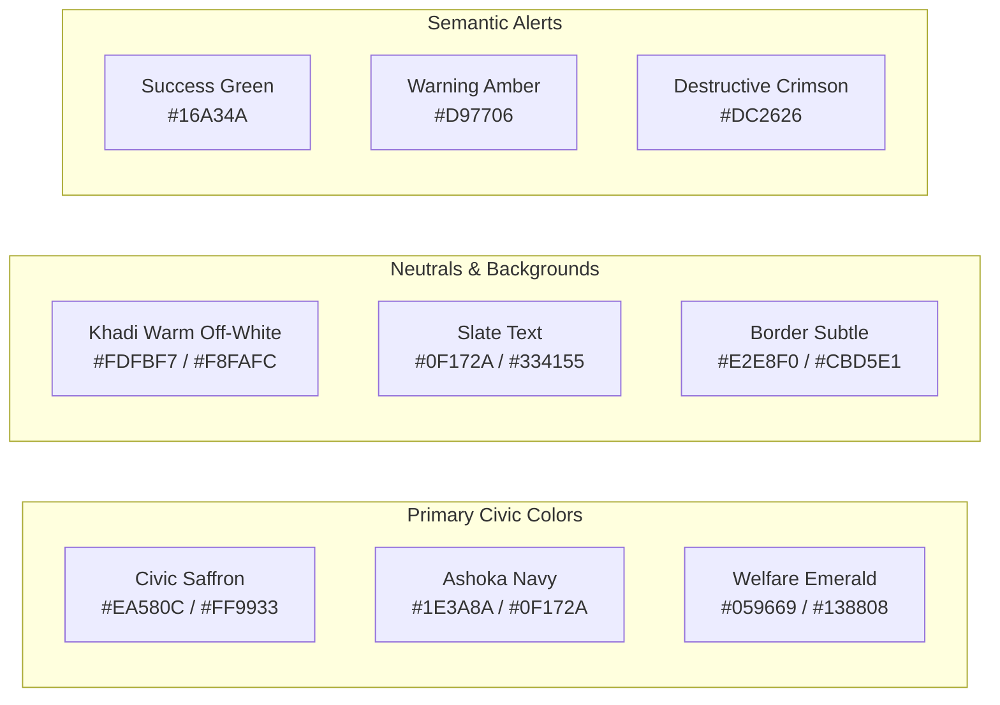

# JANASEVA – Civic Design System & UI/UX Specification

> **Document Version:** 2.0.0  
> **Classification:** UI/UX Design System Specification  
> **Brand Identity:** Civic Trust, Digital India, Karnataka State Welfare Heritage  
> **WCAG Compliance:** Level AA (ISO/IEC 40500)

---

## 1. Design Philosophy & Principles

JANASEVA’s design system is built specifically for **inclusive civic technology**. The interface must serve diverse users: from tech-savvy college students to first-time smartphone users in rural villages who may speak only Kannada or Hindi and possess limited digital literacy.

### Core Tenets
1. **Unquestioned Civic Trust:** Visuals must convey official authenticity, clarity, and institutional calm—avoiding flashy commercial UI gimmicks or deceptive dark patterns.
2. **Cognitive Simplicity:** Plain language, large touch targets, high-contrast visual cues, and iconography that communicates function even before text is read.
3. **Multilingual Typographic Parity:** Kannada (ಕನ್ನಡ), Hindi (हिंदी), and English are treated as primary citizens. Fonts, vertical line-heights, and word wraps are engineered to avoid glyph clipping in complex Indic scripts.
4. **Resilient Multimodal Interaction:** Every critical workflow can be executed via touch, keyboard navigation, or natural voice conversation.

---

## 2. Color Palette & Design Tokens

The color palette draws inspiration from the national colors of India (Tiranga: Saffron, White, Green, and Ashoka Navy) combined with Karnataka’s civic identity (Deep Saffron-Turmeric and Emerald Green).



### 2.1 Color Tokens

| Token Name | Hex Code | Tailwind Class | Contrast (on Light) | Purpose & Usage |
| :--- | :--- | :--- | :--- | :--- |
| `--color-primary-saffron` | `#EA580C` | `text-amber-600` / `bg-orange-600` | 4.8:1 | Primary call-to-actions, accent badges, active tab highlights |
| `--color-primary-navy` | `#1E3A8A` | `bg-blue-900` / `text-blue-900` | 10.5:1 | Top navigation header, primary headings, institutional branding |
| `--color-accent-emerald` | `#059669` | `bg-emerald-600` / `text-emerald-700` | 5.2:1 | High match score indicators, verified official badges, financial benefit amounts |
| `--color-karnataka-turmeric`| `#D97706` | `bg-amber-500` / `text-amber-600` | 4.9:1 | Karnataka State scheme tags, important advisories |
| `--color-bg-canvas` | `#F8FAFC` | `bg-slate-50` | N/A | Default page canvas background |
| `--color-bg-surface` | `#FFFFFF` | `bg-white` | N/A | Cards, modals, comparison table rows, input backgrounds |
| `--color-text-primary` | `#0F172A` | `text-slate-900` | 15.8:1 | Main headings, body copy, active text |
| `--color-text-secondary` | `#475569` | `text-slate-600` | 7.0:1 | Secondary metadata, department names, helper labels |
| `--color-border-subtle` | `#E2E8F0` | `border-slate-200` | N/A | Card borders, dividers, table horizontal rules |

### 2.2 Semantic Status Tokens

| Semantic State | Background Token | Text Token | Icon Association | Contextual Meaning |
| :--- | :--- | :--- | :--- | :--- |
| **High Match ($\ge 80\%$)** | `bg-emerald-50` (`#ECFDF5`) | `text-emerald-700` (`#047857`) | `CheckCircle2` | Citizen satisfies all mandatory criteria |
| **Partial Match ($50-79\%$)** | `bg-amber-50` (`#FFFBEB`) | `text-amber-800` (`#92400E`) | `AlertCircle` | Conditional eligibility or missing minor document |
| **Low Match ($<50\%$)** | `bg-rose-50` (`#FFF1F2`) | `text-rose-700` (`#BE123C`) | `XCircle` | Ineligible due to age, gender, or income limit |
| **Central Government** | `bg-blue-50` (`#EFF6FF`) | `text-blue-700` (`#1D4ED8`) | `Building2` | Centrally sponsored or central sector program |
| **State Government** | `bg-amber-50` (`#FFFBEB`) | `text-amber-700` (`#B45309`) | `Landmark` | Karnataka State departmental initiative |

---

## 3. Typography & Internationalization (i18n)

### 3.1 Font Stack
To support Indian Unicode scripts without glyph breakage, vowel sign drops, or subscript clipping, JANASEVA specifies a layered font-family cascade:

```css
/* Primary Universal Sans Stack */
font-family: 'Inter', -apple-system, BlinkMacSystemFont, 'Segoe UI', 
             'Noto Sans', 'Noto Sans Kannada', 'Noto Sans Devanagari', 
             Roboto, sans-serif;
```

- **English & Numerals:** `Inter` / `system-ui` for crisp rendering of tabular numerals and application codes.
- **Kannada (ಕನ್ನಡ):** `'Noto Sans Kannada'`, `'Tunga'`, `'Kootan'` with explicit `line-height: 1.6` to accommodate compound vowel signs (*ottu* and *matra*).
- **Hindi (हिंदी):** `'Noto Sans Devanagari'`, `'Mangal'` with explicit `line-height: 1.55` for top *shirorekha* bar clarity.

### 3.2 Modular Scale & Hierarchy

| Scale Token | Font Size | Desktop Line Height | Weight | Tailwind Class | UI Application |
| :--- | :--- | :--- | :--- | :--- | :--- |
| `display-1` | 36px / 2.25rem | 44px (1.2) | 800 (Extrabold) | `text-3xl sm:text-4xl font-extrabold` | Hero headlines, portal banner |
| `h1` | 30px / 1.875rem | 38px (1.25) | 700 (Bold) | `text-2xl sm:text-3xl font-bold` | Page titles (Directory, Checker, Admin) |
| `h2` | 24px / 1.5rem | 32px (1.33) | 700 (Bold) | `text-xl sm:text-2xl font-bold` | Section headings, modal titles |
| `h3` | 18px / 1.125rem | 26px (1.44) | 600 (Semibold) | `text-lg font-semibold` | Scheme card titles, wizard step headers |
| `body-base` | 16px / 1rem | 24px (1.5) | 400 (Regular) | `text-base text-slate-700` | Main paragraphs, criteria explanations |
| `body-sm` | 14px / 0.875rem | 20px (1.42) | 500 (Medium) | `text-sm text-slate-600` | Document checklists, card metadata |
| `caption` | 12px / 0.75rem | 16px (1.33) | 600 (Semibold) | `text-xs uppercase tracking-wide` | Badges, timestamps, match score labels |

---

## 4. Spacing, Elevation & Layout Grid

### 4.1 Spacing Scale (4px Base Grid)
- `space-1` (4px), `space-2` (8px), `space-3` (12px), `space-4` (16px), `space-6` (24px), `space-8` (32px), `space-12` (48px).
- **Card Padding:** `p-5` (20px) on mobile, `p-6` (24px) on desktop.
- **Form Element Spacing:** `gap-4` (16px) between inputs, `gap-6` (24px) between fieldsets.

### 4.2 Elevation & Shadow Tokens
- `elevation-0`: `shadow-none border border-slate-200` (Flat inputs, nested panels).
- `elevation-1`: `shadow-sm hover:shadow-md transition-shadow` (Standard scheme cards, document items).
- `elevation-2`: `shadow-md` (Sticky navigation bar, dropdown menus, filter drawers).
- `elevation-3`: `shadow-xl border border-slate-100` (Interactive modals, voice assistant floating widget).

### 4.3 Border Radii
- `rounded-lg` (8px): Form input controls, buttons, table cell selections.
- `rounded-xl` (12px): Scheme cards, analytics chart containers, filter panels.
- `rounded-2xl` (16px): Main modal dialogs, voice assistant floating panel.
- `rounded-full`: Status pills, avatar circles, voice recording trigger button.

---

## 5. Core Component Specifications

### 5.1 Scheme Card Component
```
+---------------------------------------------------------------+
| [ Central / Karnataka State Badge ]     [ Bookmark Icon (★) ] |
|                                                               |
| SCHEME TITLE (e.g., Gruha Lakshmi Yojana)                     |
| Dept: Women & Child Development Department                    |
|                                                               |
| Objective: Monthly financial assistance of ₹2,000 to woman    |
| head of every household in Karnataka...                       |
|                                                               |
| 💰 Benefit: ₹2,000 / month      🎂 Age: 18 - 60 years         |
| 📜 Required: Ration Card, Aadhaar (Auth), Bank Passbook       |
|                                                               |
| [ Check Eligibility ]                  [ Apply Official Link ↗ ]|
+---------------------------------------------------------------+
```
- **State Badges:** Karnataka State uses an amber border with warm background (`border-amber-200 bg-amber-50 text-amber-800`), while Central schemes use civic blue (`border-blue-200 bg-blue-50 text-blue-800`).
- **Benefit Pill:** Bold emerald text with currency glyph (`₹`) emphasizing financial assistance.
- **Interactions:** Subtle scale effect on card hover (`hover:-translate-y-1 transition-all duration-200`).

### 5.2 3-Step Eligibility Wizard
- **Progress Stepper:** Numbered circle indicators connected by a horizontal progress bar. Active step highlighted in civic saffron (`bg-orange-600 text-white`), completed steps in emerald (`bg-emerald-600 text-white` with checkmark icon), and future steps in muted slate (`bg-slate-200 text-slate-500`).
- **Sliders & Selection Cards:** Large radio card tiles with icons (e.g., Farmer tractor icon, Student graduate cap icon) for one-touch selection on mobile devices.
- **Result Score Gauge:** Circular or high-contrast horizontal progress meter showing exact Match Percentage with clear qualitative badge (`Highly Eligible`, `Partially Eligible`).

### 5.3 Voice Assistant Interface
- **Floating Launcher:** Circular button anchored to the bottom-right (`bottom-6 right-6 z-50`), with a dynamic pulsing halo indicating voice readiness.
- **Waveform Animation:** Multi-bar audio waveform that animates dynamically when the assistant is speaking.
- **Barge-In Button:** High-visibility "Interrupt / Tap to Speak" button allowing citizens to instantly cut off TTS playback.
- **Transcript Bubble:** Left-aligned speech bubble for assistant messages with source verification badge (`Verified from Official Gazette`), and right-aligned bubble for citizen utterances.

### 5.4 Comparison Matrix
- **Header:** Sticky table header displaying side-by-side scheme names with individual remove/replace buttons.
- **Row Attributes:** Distinct zebra-striped rows alternating between `bg-white` and `bg-slate-50/50`.
- **Differential Highlight:** Where criteria diverge (e.g., ₹2 Lakh income cap vs. ₹3 Lakh), the cells feature a subtle amber accent border.

---

## 6. Accessibility & Inclusivity Guidelines (WCAG 2.1 AA)

1. **Color Independence:** Color is never used as the sole indicator of status. Every match percentage, scheme type, and application state is accompanied by an explicit text label and distinctive Lucide icon.
2. **Keyboard Navigation:** Every interactive element has an explicit `:focus-visible` state:
   ```css
   focus-visible:outline-none focus-visible:ring-2 focus-visible:ring-orange-500 focus-visible:ring-offset-2
   ```
3. **Screen Reader Semantics:**
   - ARIA live regions (`aria-live="polite"`) for real-time speech assistant transcripts and search result count updates.
   - Distinct `aria-label` attributes on icon-only buttons (e.g., `aria-label="Save Gruha Lakshmi to bookmarks"`).
4. **Motion Safeguards:** Supports `prefers-reduced-motion` media queries by disabling floating badge bounce animations and pulsing rings for users with vestibular sensitivities.
