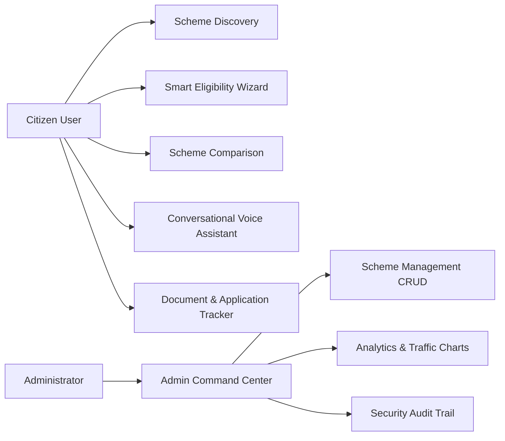

# JANASEVA – Product Requirements Document (PRD)

> **Document Version:** 2.0.0  
> **Status:** Approved / Production Specification  
> **Target Audience:** Citizens, Administrators, Civic Technology Stakeholders, Evaluators  
> **Repository:** [Jana-Seva](https://github.com/Sachinxcode-01/jana-seva.git)

---

## 1. Executive Summary

### 1.1 Product Vision
**JANASEVA** (*"Service to the People"*) is an inclusive, privacy-first civic technology platform designed to eliminate the information asymmetry surrounding Central and State government welfare schemes in India. By combining intuitive web navigation, a deterministic multi-variable eligibility engine, side-by-side comparison matrices, a personal citizen application tracker, and a multilingual conversational AI voice assistant, JANASEVA enables every citizen—regardless of literacy level or technical background—to claim their statutory rights without falling victim to predatory middlemen or fraudulent intermediaries.

### 1.2 The Problem
Over 800+ social welfare schemes exist across Central and State ministries in India, allocating tens of billions of rupees annually for social support. However:
1. **Information Fragmentation:** Schemes are scattered across dozens of disparate ministerial portals (Seva Sindhu, NSP, PM-KISAN, National Portal of India), written in complex bureaucratic jargon.
2. **Eligibility Ambiguity:** Citizens cannot easily ascertain whether they meet specific income thresholds, age brackets, or caste/category restrictions without visiting government offices.
3. **Predatory Intermediaries:** Unscrupulous private cyber-café operators and brokers charge excessive fees (₹200 to ₹1,500) for standard, free public application submissions.
4. **Language & Digital Literacy Barrier:** Millions of rural farmers, daily-wage laborers, and senior citizens speak regional languages (such as Kannada or Hindi) and cannot navigate English-only bureaucratic web interfaces.
5. **Data Privacy Risks:** Citizens frequently upload sensitive credentials (Aadhaar cards, bank passbooks) to unregulated third-party portals, leading to identity theft and subsidy diversion.

### 1.3 The Solution
JANASEVA provides:
- A single, centralized, verified scheme directory categorized by demographic and sector.
- A 3-step privacy-safe eligibility checker that computes a quantitative Match Score and clearly explains met and unmet conditions.
- Zero-sensitive-data architecture (strictly never collecting Aadhaar numbers, bank account numbers, or biometric credentials).
- Side-by-side comparative analysis of welfare programs.
- A multilingual interface natively supporting English, Kannada (ಕನ್ನಡ), and Hindi (हिंदी).
- An Indian female conversational AI voice assistant (`kavya-indic`) capable of real-time speech interaction and barge-in interruption.
- A transparent application and document tracker for citizens and a rich analytics command center for civic administrators.

---

## 2. Target User Personas

| Persona | Demographics & Context | Primary Pain Points | Key JANASEVA Features Used |
| :--- | :--- | :--- | :--- |
| **Ramesh (Small Farmer)** | Age 48, Mandya District, Karnataka. Speaks Kannada. Owns 1.5 acres of dry land. | Unsure if smallholders qualify for PM-KISAN or state crop insurance; intimidated by digital English forms. | Kannada voice assistant, Farmer Welfare category, Step-by-step document checklist for RTC Pahani. |
| **Sunita (Homemaker & Mother)** | Age 36, Belagavi, Karnataka. Annual family income ₹1,20,000. Basic smartphone user. | Wants to know if she qualifies for *Gruha Lakshmi* and *Shakti*; wary of cyber café scams. | 3-Step Eligibility Checker, Gruha Lakshmi official links, zero-data requirement, WhatsApp/SMS sharing. |
| **Kiran (First-Gen Student)** | Age 19, Mysuru. Pursuing B.Sc. First generation in family attending college. | Overwhelmed by duplicate forms across SSP and NSP; missing application deadlines. | Student Scholarship directory, SSP vs. NSP Scheme Comparison, Application Tracker ledger. |
| **Abdul (Micro-Vendor)** | Age 42, Bengaluru urban street vendor. Low digital literacy. | Needs low-interest working capital for inventory; lacks collateral for commercial banks. | PM SVANidhi discovery, Hindi/Kannada voice assistant inquiries, required municipal certificate checklist. |
| **Pooja (Welfare Administrator)** | Taluk Welfare Officer / Academic Administrator. | Needs macro-level visibility into scheme interest, application trends, and demographic outreach. | Admin Command Center, Recharts analytics, Scheme CRUD manager, system audit logging. |

---

## 3. Product Scope & Functional Requirements

### 3.1 Feature Module 1: Government Scheme Repository & Directory
- **FR-1.1 Classification:** Schemes must be partitioned into **Central Government** and **State Government (Karnataka)** programs.
- **FR-1.2 Categorization:** Schemes must be mapped to at least six functional categories:
  1. *Women Empowerment* (e.g., Gruha Lakshmi, Matru Vandana)
  2. *Student Scholarships* (e.g., SSP Karnataka, NSP Post-Matric)
  3. *Farmer Welfare* (e.g., PM-KISAN, PMFBY Crop Insurance)
  4. *Employment Opportunities* (e.g., Yuva Nidhi, MGNREGA)
  5. *Financial Assistance* (e.g., PM SVANidhi, MUDRA loans)
  6. *Health and Social Welfare* (e.g., Ayushman Bharat – PM-JAY / Arogya Karnataka)
- **FR-1.3 Scheme Detail View:** Each scheme page must render:
  - Official scheme title, governing department, and nodal ministry.
  - Plain-language objective and quantitative financial or in-kind benefits.
  - Comprehensive eligibility criteria (age boundaries, income ceiling, state domicile, gender, occupation).
  - Explicit required document checklist with issuing authorities.
  - Direct hyperlinks to official government submission portals (e.g., `sevasindhu.karnataka.gov.in`, `pmkisan.gov.in`).
  - Prominent statutory advisory clarifying that application submission is free on government portals.

### 3.2 Feature Module 2: Search, Filter & Discovery
- **FR-2.1 Instant Search:** Live multi-attribute keyword search across scheme title, description, category, and department with debounced execution (<150ms).
- **FR-2.2 Multi-Facet Filters:**
  - Filtering by Government Type (`All`, `Central`, `State`).
  - Filtering by Category (`All`, `Women`, `Students`, `Farmers`, `Employment`, `Finance`, `Healthcare`).
  - Filtering by Beneficiary (`All`, `Women`, `Farmers`, `Students`, `Unemployed Youth`, `Street Vendors`, `BPL Families`).
- **FR-2.3 Sorting Capabilities:** Options to sort by `Recently Updated`, `Most Viewed`, and `Alphabetical (A-Z)`.

### 3.3 Feature Module 3: Smart Eligibility Engine
- **FR-3.1 3-Step Privacy-Safe Wizard:**
  - *Step 1 (Demographics):* Age, Gender (`Female`, `Male`, `Other`), State Domicile (`Karnataka`, `Other`).
  - *Step 2 (Socio-Economic):* Occupation (`Farmer`, `Student`, `Unemployed`, `Self-Employed`, `Salaried`, `Retired`), Beneficiary Category (`General`, `OBC`, `SC`, `ST`, `BPL/EWS`).
  - *Step 3 (Financial):* Annual Family Income (Interactive slider with presets from ₹0 to ₹10,00,000+).
- **FR-3.2 Deterministic Evaluation:** The engine must execute an explainable algorithm evaluating:
  - Gender eligibility constraint ($0\%$ match if strict gender restriction violated).
  - State domicile condition ($0\%$ match if state-specific scheme and resident out-of-state).
  - Age window bounds ($MinAge \le Age \le MaxAge$).
  - Annual income ceiling ($Income \le IncomeLimit$).
  - Target occupation alignment.
- **FR-3.3 Match Output & Explainability:**
  - Output an overall Match Score percentage (0% to 100%).
  - Categorization into `High Match` ($\ge 80\%$), `Partial Match` ($50\% - 79\%$), and `Low Match` ($<50\%$).
  - Render an explicit checklist of **Conditions Met** (e.g., "Annual income below ₹2,00,000") and **Conditions Unmet / Clarifications** (e.g., "Requires Karnataka domicile").
  - Direct "View Scheme & Documents" CTA button.

### 3.4 Feature Module 4: Scheme Comparison Matrix
- **FR-4.1 Multi-Selection:** Users can select 2 or 3 schemes for simultaneous side-by-side comparison.
- **FR-4.2 Comparative Metrics:** The comparison matrix must display:
  - Governing Department & Government Level.
  - Direct Financial Benefits & Frequency (Monthly/Annual/One-time).
  - Income Ceiling Limits.
  - Eligible Age Limits.
  - Minimum Required Documents.
  - Official Application Portal links.
- **FR-4.3 Visual Highlighting:** Automatically highlight key differentiating factors (e.g., difference in income caps).

### 3.5 Feature Module 5: Multilingual Inclusivity (i18n)
- **FR-5.1 Supported Languages:** Full UI translation and data presentation in:
  1. English (`en`)
  2. Kannada (`kn` – ಕನ್ನಡ)
  3. Hindi (`hi` – हिंदी)
- **FR-5.2 Persistent Language Selection:** User preference saved to local storage and preserved across browser sessions.
- **FR-5.3 Typographic Alignment:** Kannada and Devanagari text rendered with proper line-height scaling and Noto Sans font families to avoid glyph clipping.

### 3.6 Feature Module 6: Citizen Application & Document Tracker
- **FR-6.1 Personal Application Ledger:** Authenticated citizens can track their official government submissions:
  - Scheme Name & Department.
  - Official Government Application / Acknowledgement Number (e.g., `KL-GL-2026-98124`).
  - Submission Date.
  - Current Status (`Draft`, `Submitted`, `In Review`, `Approved`, `Rejected`).
  - Custom notes and next follow-up dates.
- **FR-6.2 Document Vault Checklist:** Status tracking for personal documents (`Aadhaar Card`, `Income Certificate`, `Ration Card`, `Bhoomi RTC`, `Caste Certificate`) with status indicators (`Available`, `Expiring Soon`, `Need to Apply`).
- **FR-6.3 Zero File Storage:** No original citizen document images or PDF certificates are uploaded or stored on JANASEVA servers, ensuring complete privacy compliance.

### 3.7 Feature Module 7: Conversational AI Voice Assistant
- **FR-7.1 Speech-to-Text & Text-to-Speech:**
  - Real-time speech recognition supporting Indian accents and phonetic transcription.
  - Voice output synthesized using dedicated Indian female voice profiles (`kavya-indic`, `priya-in`, `neerja-in`).
  - Zero-dependency browser fallback using the WebSpeech SpeechSynthesis API (`en-IN`, `hi-IN`, `kn-IN`).
- **FR-7.2 Grounded Retrieval-Augmented Generation (RAG):**
  - Assistant answers queries strictly using verified scheme data from the JANASEVA knowledge base.
  - When details are unknown or ambiguous, the assistant explicitly states lack of official data and provides official helpdesk contacts.
- **FR-7.3 Real-Time Interruption (Barge-In):**
  - Citizens can speak or tap "Interrupt" while the assistant is speaking, instantly halting speech playback and initiating new query listening.
- **FR-7.4 Code-Switching Support:** Handles hybrid linguistic queries (e.g., Kannada-English or Hindi-English colloquial phrases).

### 3.8 Feature Module 8: Administrative Command Center
- **FR-8.1 Interactive Visual Analytics:**
  - Distribution of Schemes by Category (Bar / Pie chart via Recharts).
  - Central vs. Karnataka State Scheme breakdown (Donut chart).
  - Most Viewed Schemes traffic metrics.
- **FR-8.2 Scheme CRUD Operations:**
  - Add new welfare schemes with full eligibility parameters and multilingual translations.
  - Update benefit amounts, deadlines, or document requirements.
  - Delete retired or superseded schemes with safety confirmations.
- **FR-8.3 System Audit Trail:**
  - Immutable audit logging of administrative actions with timestamp, user ID, action type (`CREATE`, `UPDATE`, `DELETE`), and affected scheme.

---

## 4. Non-Functional Requirements (NFRs)

### 4.1 Performance & Latency
- **NFR-1.1 Frontend Load Time:** Initial render within 1.5 seconds on standard 4G mobile connections.
- **NFR-1.2 API Response Time:** 95th percentile latency < 120ms for directory queries and < 50ms for eligibility evaluations.
- **NFR-1.3 Voice Streaming Latency:** Time to first audio packet < 600ms when running local VoiceStudio, and < 150ms on WebSpeech browser fallback.

### 4.2 Security & Privacy
- **NFR-2.1 Zero Sensitive PII:** Under no circumstances shall JANASEVA request, transmit, or store 12-digit Aadhaar numbers, biometric data, bank account numbers, IFSC codes, or PAN numbers.
- **NFR-2.2 Cryptographic Safeguards:** Password storage hashed using BCrypt (cost factor 10). Authentication tokens issued as signed JSON Web Tokens (JWT) with HMAC-SHA256 and 24-hour expiration.
- **NFR-2.3 API Defense:** Strict CORS origin whitelisting, HTTP security headers enforced via Helmet, and rate limiting on authentication and assistant endpoints (5 attempts/15 min on login, 60 requests/min on public APIs).

### 4.3 Accessibility & Inclusivity (a11y)
- **NFR-3.1 Compliance:** Conformance with **WCAG 2.1 Level AA** standards.
- **NFR-3.2 Color Contrast:** Minimum contrast ratio of 4.5:1 for normal text and 3:1 for large graphical elements.
- **NFR-3.3 Screen Reader Compatibility:** Semantic HTML5 elements (`<main>`, `<nav>`, `<section>`, `<article>`), explicit ARIA attributes (`aria-expanded`, `aria-label`, `aria-live="polite"` for voice streaming).
- **NFR-3.4 Touch Targets:** Minimum interactive touch target dimension of 44 × 44 pixels for mobile screens.

### 4.4 Reliability & Maintainability
- **NFR-4.1 Offline Lab Portability:** The application must be fully functional for lab examination and offline demos with zero external cloud database dependencies, utilizing `janaseva_db.json` transactional storage.
- **NFR-4.2 Graceful Degradation:** If the voice server (`localhost:3900`) is offline, the client seamlessly falls back to the native browser WebSpeech synthesis without displaying errors to the citizen.

---

## 5. Metrics & Key Performance Indicators (KPIs)

1. **Eligibility Completion Rate:** Target $\ge 85\%$ of users who start the 3-step wizard reach the final match results screen.
2. **Citizen Advisory Satisfaction:** $\ge 90\%$ positive feedback on the clarity of required document checklists.
3. **Voice Engagement in Indic Languages:** $\ge 60\%$ of voice assistant conversations conducted in Kannada or Hindi.
4. **Middleman Cost Avoidance:** Number of direct official portal handoffs multiplied by estimated average broker fee (₹300/application).

---

## 6. Release Roadmap & Milestones

| Milestone | Deliverables | Target Horizon |
| :--- | :--- | :--- |
| **Phase 1: Foundation (Current)** | Scheme directory (Central + Karnataka), 3-step eligibility wizard, scheme comparison, trilingual i18n, transactional JSON DB, admin analytics, VoiceStudio integration. | **Production Ready (Lab CBP 2026)** |
| **Phase 2: Push Notifications** | Web Push and SMS notifications for impending scheme application deadlines and new scheme launches. | Q3 2026 |
| **Phase 3: Offline PWA & Sync** | Progressive Web App (PWA) with Service Workers for offline scheme browsing in low-connectivity rural panchayats. | Q4 2026 |
| **Phase 4: Direct Digilocker Verification** | Voluntary, read-only OAuth integration with DigiLocker to auto-verify eligibility criteria without storing citizen files. | Q1 2027 |
