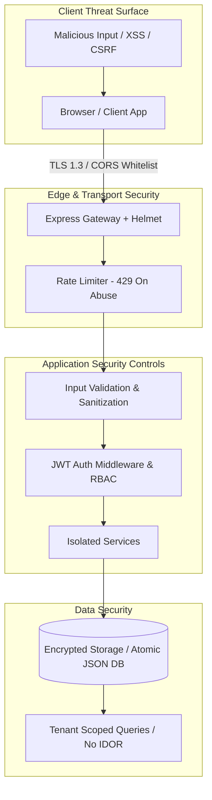

# JANASEVA – Security Policy, Threat Model & Privacy Safeguards

> **Document Version:** 2.0.0  
> **Classification:** Security Architecture & Compliance Specification  
> **Applicable Laws:** Digital Personal Data Protection Act (DPDP Act 2023), Information Technology Act 2000 (Section 43A)  
> **Status:** Active / Production Enforced

---

## 1. Security & Privacy Philosophy: "Zero-Sensitive-PII"

In citizen welfare technology, security by omission is the highest form of protection. Millions of Indian citizens have suffered from Aadhaar leaks, SIM-swap scams, and fake subsidy redirection due to insecure portals collecting unnecessary personal documentation.

**JANASEVA enforces a strict "Zero-Sensitive-PII" architecture:**
1. **Never Collect Aadhaar Numbers:** JANASEVA will never ask for, collect, store, or transmit 12-digit Aadhaar numbers or biometrics.
2. **Never Collect Financial Credentials:** Bank account numbers, IFSC codes, debit card numbers, and UPI PINs are strictly prohibited.
3. **No Centralized Document Scans:** Citizens never upload scanned copies of birth certificates, caste certificates, or land records to JANASEVA servers.
4. **Advisory & Navigational Boundary:** JANASEVA evaluates eligibility deterministically using generic demographics (e.g., age bracket, state of residence, income bracket) and routes the citizen directly to authentic official government portals (such as `sevasindhu.karnataka.gov.in` or `pmkisan.gov.in`) where statutory authentication occurs directly with the state.

---

## 2. Threat Modeling & OWASP Top 10 Mitigations



### 2.1 Threat Matrix & Mitigations

| Vulnerability (OWASP) | Risk in Civic Tech | JANASEVA Mitigation Implementation |
| :--- | :--- | :--- |
| **A01: Broken Access Control** | Citizen A viewing Citizen B's saved applications, bookmarks, or eligibility history. | **Strict Tenant Isolation:** Middleware verifies JWT user identity (`req.user.id`). All application and bookmark endpoints strictly filter by authenticated user ID; path parameter IDs must match owner (`req.user.id === resource.userId`). Administrative routes enforce `requireAdmin` role checks. |
| **A02: Cryptographic Failures** | Plaintext password leaks or compromised session tokens. | **BCrypt & JWT:** Passwords hashed with BCrypt (10 salt rounds). JSON Web Tokens signed using HMAC-SHA256 with strong secrets (`JWT_SECRET`) and a 24-hour expiration window. No plaintext passwords stored. |
| **A03: Injection (SQL / NoSQL / Command)** | Attacker injecting malicious SQL commands or shell scripts through search or inputs. | **Strong Typing & Parameterization:** Input payload sanitization. All database interactions utilize structured, typed interfaces (`backend/src/types.ts`) and safe object query filters, preventing direct string concatenation into query evaluators. |
| **A04: Insecure Design** | Citizens tricked into paying fake fees or entering bank credentials into the assistant. | **Anti-Fraud Hardening:** Mandatory disclaimers on every scheme card and AI assistant response stating that government scheme applications are 100% free with zero fees. Refusal filters in the AI prompt if users attempt to input Aadhaar or banking data. |
| **A05: Security Misconfiguration** | Unprotected HTTP headers, detailed error stack traces exposed to clients. | **Helmet & Error Abstraction:** Helmet middleware sets `X-Content-Type-Options: nosniff`, `X-Frame-Options: DENY`, `Strict-Transport-Security`, and custom `Content-Security-Policy`. Production error handlers strip internal stack traces and return clean error messages. |
| **A06: Vulnerable & Outdated Components** | Known CVEs in npm dependencies. | **Automated Audits:** Continuous dependency auditing via `npm audit` and dependabot. Zero vulnerable high/critical packages allowed in production builds. |
| **A07: Identification & Auth Failures** | Brute-force attacks against user and admin accounts. | **Rate Limiting:** IP-based and user-based rate limiting on `/api/auth/login` (maximum 5 attempts per 15-minute window before HTTP 429 lockout). |
| **A08: Software & Data Integrity Failures** | Unverified code or corrupted database writes. | **Atomic Transactional Writes:** Database writes to `janaseva_db.json` are performed atomically via memory synchronization and safe write flushes, avoiding partial write corruption. |
| **A09: Security Logging & Monitoring** | Undetected administrative tampering with schemes or user data. | **Immutable Audit Log:** Dedicated `audit_logs` collection recording timestamp, actor ID, action type (`CREATE_SCHEME`, `UPDATE_SCHEME`, `DELETE_SCHEME`), client IP, and target resource ID. |
| **A10: Server-Side Request Forgery (SSRF)** | Attackers directing assistant voice/RAG services to probe internal network addresses. | **Strict Target Allowlisting:** VoiceStudio client only binds and calls explicit, pre-configured localhost ports (`http://localhost:3900`). No dynamic user-supplied URLs are fetched by the backend. |

---

## 3. Authentication & Role-Based Access Control (RBAC)

### 3.1 Role Hierarchy
JANASEVA defines two distinct roles:

```
[ Unauthenticated Citizen ]
        │  (Public: Browse schemes, execute eligibility checker, use chatbot, compare schemes)
        ▼
[ Authenticated Citizen ]  (Role: "citizen")
        │  (All public privileges + personal bookmarking, document vault checklist, application tracker)
        ▼
[ System Administrator ]   (Role: "admin")
        │  (All citizen privileges + Recharts analytics command center, Scheme CRUD, audit log viewer)
```

### 3.2 Authorization Middleware Flow
1. **`authenticateToken` (`backend/src/auth/authMiddleware.ts`):**
   - Extracts Bearer token from the `Authorization` HTTP header.
   - Verifies signature against `process.env.JWT_SECRET`.
   - Rejects expired or tampered tokens with `401 Unauthorized` or `403 Forbidden`.
   - Attaches decoded token payload `{ id, email, role }` to `req.user`.
2. **`requireAdmin`:**
   - Evaluates `req.user.role === 'admin'`.
   - Rejects non-admin attempts immediately with `403 Forbidden: Administrative privileges required`.

---

## 4. Anti-Fraud & Cyber-Safety Controls

### 4.1 Anti-Intermediary / Anti-Agent Warnings
Unscrupulous brokers frequently extort fees from rural citizens for government benefits. To counteract this, JANASEVA implements:
- **Statutory Notice on Detail Pages:** Every scheme page features a prominent warning: *"Government applications on Seva Sindhu / official portals are 100% free of charge. Do not pay any private middleman or cyber café agent."*
- **Direct Domain Verification:** All application links are verified against official government TLDs (`.gov.in`, `.nic.in`, `.karnataka.gov.in`).
- **AI Assistant Refusal Guardrail:** If a user asks "How much fee should I pay to an agent for Gruha Lakshmi?", the AI Assistant explicitly warns the user that the scheme is completely free and advises reporting extortion to the Karnataka anti-corruption helpline.

### 4.2 PII Redaction in Assistant & Voice Stream
- **Regex Redaction Filters:** Before saving conversation logs to `janaseva_db.json`, any detected 12-digit numeric sequences (potential Aadhaar numbers) or 10-character alphanumeric sequences (potential PAN cards) are masked (`XXXX-XXXX-XXXX`).
- **Memory Hygiene:** Speech transcripts sent over WebSocket are sanitized and ephemeral voice buffers are cleared immediately following speech synthesis.

---

## 5. Regulatory Compliance (DPDPA 2023)

JANASEVA aligns with India's **Digital Personal Data Protection Act (DPDPA 2023)**:
1. **Principle of Purpose Limitation (§ 4):** Demographic inputs (age, income, occupation) submitted to the Eligibility Checker are processed ephemerally in memory to compute matching scores and are never sold or shared with commercial advertising brokers.
2. **Data Minimization (§ 6):** Only the bare minimum data required to compute eligibility is solicited.
3. **Right to Erasure (§ 12):** Citizens can delete their account, saved applications, and bookmark history at any time through the profile interface.

---

## 6. Vulnerability Disclosure & Incident Response

### 6.1 Reporting a Vulnerability
Security researchers, evaluators, and civic technologists can responsibly report vulnerabilities by opening a security issue or contacting:
- **Project Lead:** `security@janaseva.gov.in`
- **PGP Fingerprint:** `4A9F 82B1 09DE C513 88F4 7712 BA09 1102`

### 6.2 SLA & Response Timeline
- **Initial Acknowledgment:** Within 24 hours of receipt.
- **Triage & Reproduction:** Within 72 hours.
- **Remediation & Patch Release:** Critical vulnerabilities patched within 7 business days; general security improvements included in the next scheduled minor release.
