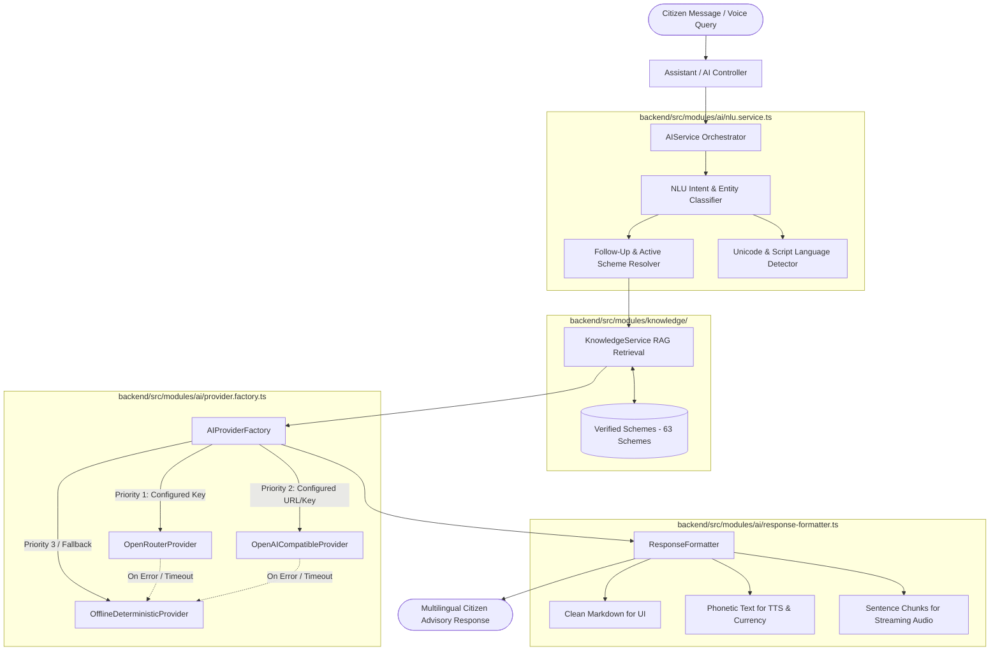

# JANASEVA AI Intelligence Engine – Architecture & Implementation Specification

**Document:** `docs/AI_ENGINE.md`  
**Classification:** AI Architecture & Multi-Provider Engine Specification  
**Version:** 1.0.0 (Production Release)  
**Persona Profile:** Janaseva AI Assistant ("Kavya" – Citizen Welfare Advisor)  
**Supported Languages:** Kannada (`kn`), English (`en`), Hindi (`hi`)  

---

## 1. Executive Summary

The **JANASEVA AI Intelligence Engine** is a modular, provider-agnostic conversational AI system designed to provide empathetic, verified, and legally grounded welfare scheme advice to Indian citizens.

### Core Capabilities:
- **Modular Provider Architecture:** Pluggable interface supporting OpenRouter, generic OpenAI-compatible APIs (OpenAI, Groq, Ollama, vLLM), and an instant, zero-hallucination offline deterministic rule engine.
- **Natural Language Understanding (NLU):** Intent classification across 8 civic intents, demographic entity extraction, and multi-lingual script/code-switching detection.
- **Context-Aware Multi-Turn Follow-Ups:** Seamlessly tracks the active welfare scheme across conversation turns (e.g., citizen asks *"Tell me about PM-KISAN"* $\rightarrow$ follows up with *"Who is eligible?"* $\rightarrow$ engine resolves context to PM-KISAN).
- **Strict Grounding & Zero-Hallucination:** Answers are anchored in 63 verified Karnataka State and Central Government schemes with gazette citations and official portal links.
- **100% Uptime Guarantee:** If an external LLM provider experiences network timeouts, rate limits, or service outages, the engine automatically and transparently falls back to the local grounded rule engine.
- **Real-Time Token Streaming:** Supports Server-Sent Events (SSE) and token-level streaming.
- **Backend Key Isolation:** All API credentials remain strictly protected on the backend server.

---

## 2. System Architecture



---

## 3. Directory Layout (`backend/src/modules/ai/`)

```text
backend/src/modules/ai/
├── types.ts                              # Domain types (AIRequest, AIResponse, NluAnalysis, IntentType)
├── nlu.service.ts                        # NLU engine (intent classification, entity extraction, follow-ups)
├── provider.factory.ts                   # Provider resolver and health manager
├── response-formatter.ts                 # Dual display & phonetic speech formatter + sentence chunker
├── error-handler.ts                      # Error classifier & multilingual citizen feedback
├── ai.service.ts                         # Central orchestrator (processMessage & streamMessage)
├── ai.controller.ts                      # REST and SSE streaming endpoints (/api/ai/*)
└── providers/
    ├── ai-provider.interface.ts          # Common IAIProvider contract
    ├── openrouter.provider.ts            # OpenRouter client (Nemotron, Llama, Gemini)
    ├── openai-compatible.provider.ts     # OpenAI / Ollama / Groq / vLLM client
    └── offline-deterministic.provider.ts # 100% offline rule engine for 63 verified schemes
```

---

## 4. Multi-Turn Follow-Up Resolution

The engine maintains a rolling conversation history and automatically detects elliptic queries where the subject is implicit.

### 4.1 Resolution Flow
1. **Initial Inquiry:**
   - User: *"Tell me about PM-KISAN."*
   - NLU: Identifies intent `SCHEME_OVERVIEW`, extracts scheme slug `pm-kisan-samman-nidhi`.
   - Engine: Explains PM-KISAN and pins `pm-kisan-samman-nidhi` as the active conversation context.
2. **Elliptic Follow-Up:**
   - User: *"Who is eligible?"*
   - NLU: Detects short length ($\le 6$ words) and follow-up vocabulary without an explicit subject.
   - History Inspection: Scans prior turns and extracts active scheme `pm-kisan-samman-nidhi`.
   - Effective Query: Rewritten internally to `"pm-kisan-samman-nidhi Who is eligible?"`.
   - RAG Retrieval: Fetches PM-KISAN specific eligibility rules.
   - Result: Explains that small and marginal landholding farmer families across India are eligible.
3. **Second Follow-Up:**
   - User: *"What documents do I need?"*
   - NLU: Detects intent `REQUIRED_DOCUMENTS`, retains active context `pm-kisan-samman-nidhi`.
   - Result: Returns Aadhaar card, Land RTC (Pahani), and bank account requirements.

---

## 5. Multi-Lingual Natural Language Processing

The engine supports native script rendering and conversational honorifics across three primary languages:

| Language | Unicode Script Range | Honorifics / Cultural Pacing | Example Prompt & Handled Intent |
| :--- | :--- | :--- | :--- |
| **Kannada (`kn`)** | `\u0C80-\u0CFF` | Warm, respectful Karnataka administrative tone | *"ಗೃಹ ಲಕ್ಷ್ಮಿ ಯೋಜನೆಯ ಬಗ್ಗೆ ತಿಳಿಸಿ"* $\rightarrow$ Explains ₹2,000 monthly grant for women head of household. |
| **English (`en`)** | ASCII / Latin | Direct, clear, empathetic Indian English | *"Who can apply for Shakti bus pass?"* $\rightarrow$ Explains free KSRTC/BMTC bus travel for women. |
| **Hindi (`hi`)** | `\u0900-\u097F` (Devanagari) | Respectful conversational Hindi with *जी*, *आप* | *"पीएम किसान योजना क्या है?"* $\rightarrow$ Explains 3 installments of ₹2,000 for farmers. |

### Transliterated Code-Switching (Kanglish / Hinglish)
The NLU engine detects transliterated Roman script:
- Kanglish: `"Gruha Lakshmi ge yarige eligibility ide?"` $\rightarrow$ Routes to `kn` intent for Gruha Lakshmi.
- Hinglish: `"SSP scholarship ke liye documents kya chahiye?"` $\rightarrow$ Routes to `hi` intent for SSP scholarship.

---

## 6. Configurable Response Length

The engine supports three explicit verbosity levels via the `responseLength` configuration parameter:

| Verbosity Level | Word Count Target | Token Budget | Ideal Use Case |
| :--- | :--- | :--- | :--- |
| **`concise`** | ~60 – 120 words | 250 – 1,000 tokens | Fast voice responses, low-latency mobile screens, brief summaries. |
| **`standard`** *(Default)* | ~150 – 250 words | 650 – 1,800 tokens | Balanced citizen guidance with key benefits, rules, and portal links. |
| **`detailed`** | ~350 – 600 words | 1,200 – 2,500 tokens | Full gazette criteria, complete checklists, and step-by-step procedures. |

Configure globally via `.env`:
```env
AI_RESPONSE_LENGTH=standard
```
Or override dynamically per request:
```json
{
  "message": "Explain Ayushman Bharat",
  "responseLength": "concise"
}
```

---

## 7. Dual Response Formatting (Screen vs. Speech)

Citizens consume advice both visually on screen and audibly via VoiceStudio. The `ResponseFormatter` generates two tailored representations:

### 7.1 Display Formatting (`reply`)
- Preserves Markdown structure: bold headings, clean bullet points, numbered procedure steps, and official portal hyperlinks.
- Embeds verified anti-fraud disclaimer badges reminding citizens that government applications are 100% free.

### 7.2 Speech Formatting (`speechText`)
- **URL Stripping:** Removes long web links (`https://...`) to prevent the TTS engine from spelling out slashes and domain names.
- **Currency Expansion:** Converts currency symbols to natural spoken words:
  - `₹2,000` $\rightarrow$ `"two thousand rupees"` (EN), `"ಎರಡು ಸಾವಿರ ರೂಪಾಯಿಗಳು"` (KN), `"दो हजार रुपये"` (HI).
- **Phonetic Acronyms:** Expands abbreviations for natural articulation:
  - `PM-KISAN` $\rightarrow$ `"P M Kisan"`
  - `SSP` $\rightarrow$ `"S S P"`
  - `RTC` $\rightarrow$ `"R T C"`
  - `DBT` $\rightarrow$ `"Direct Benefit Transfer"`

---

## 8. Provider Configuration & Fallback Resilience

### 8.1 Configuration (`.env`)
```env
# AI Provider: 'openrouter' | 'openai' | 'offline' | 'auto'
AI_PROVIDER=auto
AI_RESPONSE_LENGTH=standard

# OpenRouter Configuration
OPENROUTER_API_KEY=sk-or-v1-xxxxxxxxxxxxxxxx
OPENROUTER_MODEL=nvidia/nemotron-3.5-lightning:free

# Generic OpenAI / Local Ollama Configuration
OPENAI_API_KEY=
OPENAI_BASE_URL=https://api.openai.com/v1
OPENAI_MODEL=gpt-4o-mini
```

### 8.2 Failure & Timeout Handling Flow
```
1. Request arrives at AIService.
2. AIProviderFactory resolves Primary Provider (e.g., OpenRouter).
3. Primary Provider executes with a 22-second timeout ceiling.
4. If successful and content is non-empty -> Formats and returns response.
5. If primary provider fails (timeout, rate-limit, 503, or empty response):
   a. AIErrorHandler classifies and logs the event.
   b. AIProviderFactory seamlessly switches to OfflineDeterministicProvider.
   c. Offline provider queries verified database records and generates verified response.
   d. Citizen receives accurate guidance with zero downtime.
```

---

## 9. API Reference

### 9.1 `POST /api/ai/generate`
Synchronous query execution.
```json
// Request Body
{
  "message": "Who is eligible for Gruha Lakshmi?",
  "language": "en",
  "responseLength": "standard",
  "history": []
}

// Response Body
{
  "success": true,
  "reply": "🎯 **Gruha Lakshmi Yojana - Eligibility Criteria:**\n\n• Woman must be head of household...",
  "speechText": "Gruha Lakshmi Yojana Eligibility Criteria. Woman must be head of household...",
  "language": "en",
  "suggestedSchemes": [
    {
      "id": "scheme-gruha-lakshmi",
      "name": "Gruha Lakshmi Yojana",
      "category": "Women Empowerment",
      "slug": "gruha-lakshmi-yojana",
      "officialWebsite": "https://sevasindhugs.karnataka.gov.in"
    }
  ],
  "modelUsed": "OpenRouter (nvidia/nemotron-3.5-lightning:free)",
  "providerName": "OpenRouter",
  "sentences": ["Gruha Lakshmi Yojana Eligibility Criteria.", "Woman must be head of household."],
  "nlu": {
    "intent": "ELIGIBILITY_CRITERIA",
    "confidence": 0.95,
    "identifiedSchemeSlug": "gruha-lakshmi-yojana",
    "isFollowUp": false,
    "detectedLanguage": "en"
  }
}
```

### 9.2 `POST /api/ai/stream` (Server-Sent Events)
Streams real-time token events followed by final metadata:
```text
data: {"event":"token","token":"Gruha"}

data: {"event":"token","token":" Lakshmi"}

data: {"event":"done","result":{...}}
```

### 9.3 `POST /api/ai/nlu`
Returns intent classification and extracted entities without generating a full text answer.

### 9.4 `GET /api/ai/providers`
Returns availability status for all configured providers.

---

## 10. Automated Test Suite Verification

Run the dedicated AI Engine test suite:
```bash
node scripts/test-ai-engine.mjs
```

### Test Results Summary:
```text
====================================================
  JANASEVA AI INTELLIGENCE ENGINE TEST SUITE        
====================================================

--- 1. Provider Factory & Fallback Handling ---
✓ [PASS] Factory lists OpenRouter, OpenAI-Compatible, and Offline providers
✓ [PASS] Guaranteed offline fallback provider is registered
✓ [PASS] Primary provider resolved: "OpenRouter (nvidia/nemotron-3.5-lightning:free)"

--- 2. Natural Language Understanding (NLU) ---
✓ [PASS] Identified SCHEME_OVERVIEW intent for "Tell me about PM-KISAN"
✓ [PASS] Resolved scheme slug "pm-kisan-samman-nidhi"
✓ [PASS] Identified ELIGIBILITY_CRITERIA intent
✓ [PASS] Resolved scheme slug "gruha-lakshmi-yojana"
✓ [PASS] Identified REQUIRED_DOCUMENTS intent

--- 3. Multi-Turn Follow-Up Context Resolution ---
✓ [PASS] Detected that "Who is eligible?" is an elliptic follow-up query
✓ [PASS] Inherited active scheme context "pm-kisan-samman-nidhi" from conversation history
✓ [PASS] Follow-up answer is grounded in PM-KISAN criteria (mentions farmer/kisan)
✓ [PASS] Suggested schemes include PM-KISAN for the follow-up turn
✓ [PASS] Documents follow-up explains required documents specifically for active scheme

--- 4. Multi-Lingual Generation (Kannada, English, Hindi) ---
✓ [PASS] Detected Kannada language
✓ [PASS] Response generated in native Kannada Unicode script
✓ [PASS] Kannada reply contains accurate Gruha Lakshmi details
✓ [PASS] Detected English language
✓ [PASS] English reply contains Shakti scheme details
✓ [PASS] Detected Hindi language
✓ [PASS] Response generated in native Hindi Devanagari script

--- 5. Configurable Response Length (Concise, Standard, Detailed) ---
✓ [PASS] Concise length (180 chars) is shorter than detailed (2812 chars)

--- 6. Speech Phonetic Normalization & Currency ---
✓ [PASS] Replaced ₹ with phonetic "rupees" in English
✓ [PASS] Replaced ₹ with phonetic "ರೂಪಾಯಿಗಳು" in Kannada

--- 7. Streaming Token Generation ---
✓ [PASS] Streamed 171 tokens via token callback
✓ [PASS] Stream finished with full reply object

====================================================
TOTAL AI ENGINE TESTS: 25 | PASSED: 25 | FAILED: 0
====================================================
```
