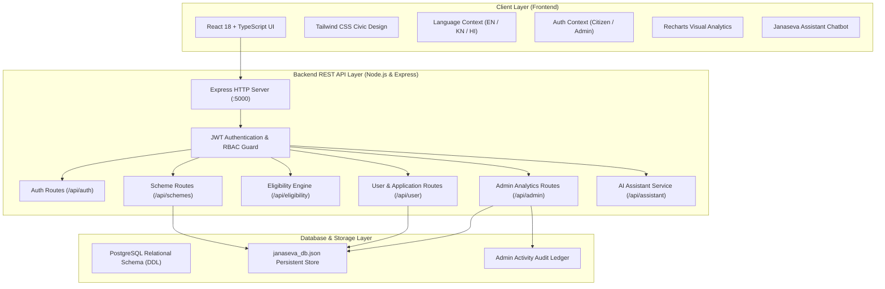
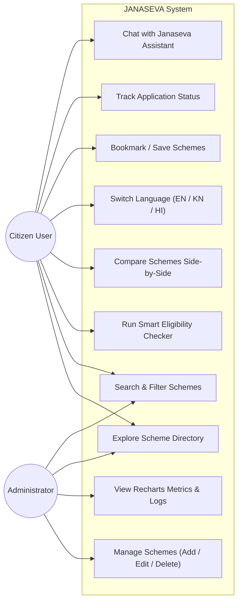
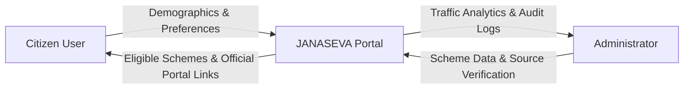
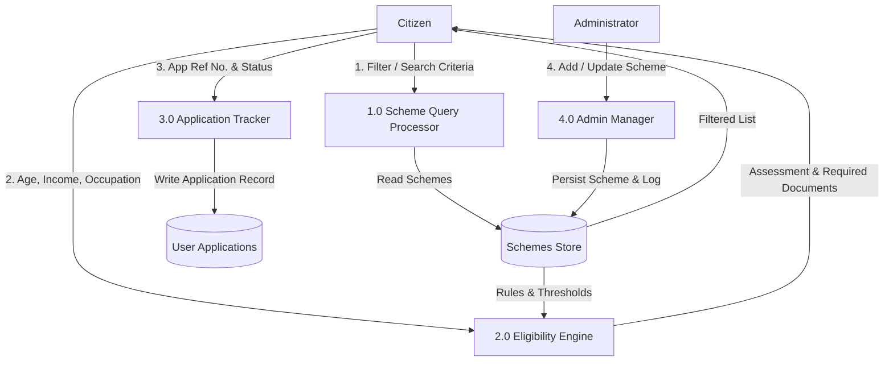
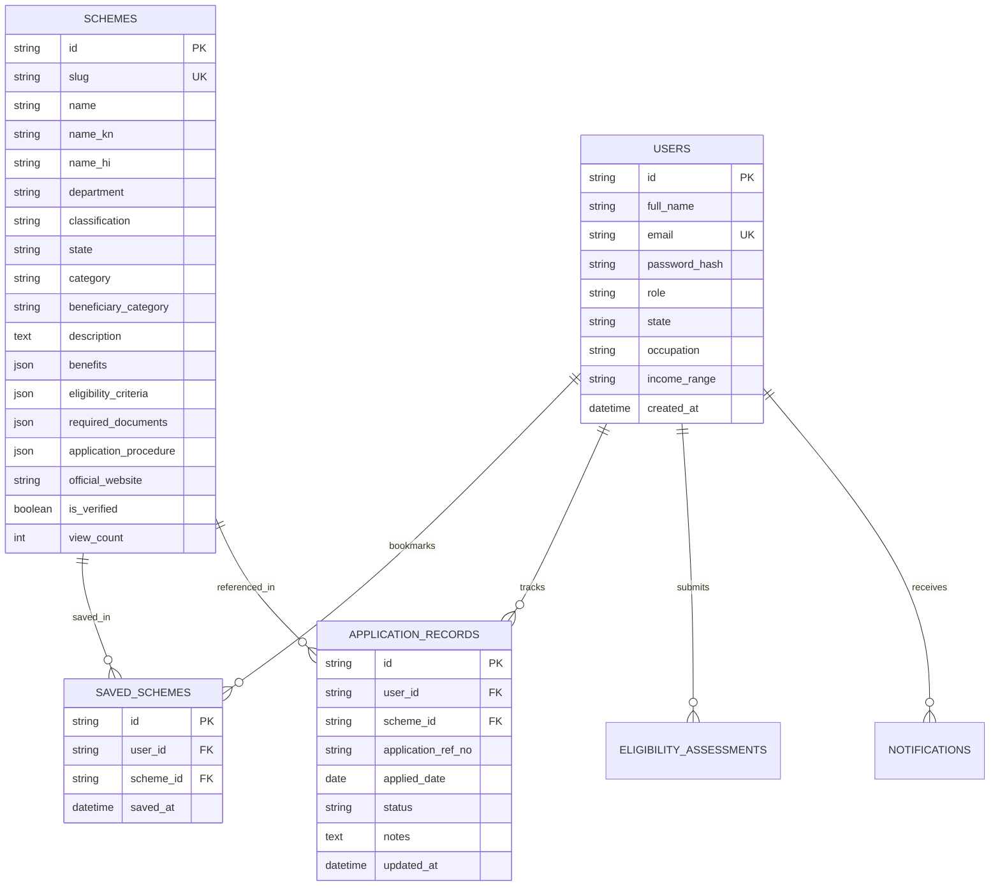

# PROJECT DOCUMENTATION

## JANASEVA – Government Scheme Awareness for Betterment of Livelihood

**A Computer Science & Engineering Computer-Based Project (CBP)**  
**Academic Year:** 2025–2026  
**Department:** Computer Science & Engineering  

---

### Table of Contents
1. Project Abstract
2. Introduction
3. Problem Statement
4. Objectives
5. Existing System & Drawbacks
6. Proposed System & Novelty
7. Hardware Requirements
8. Software Requirements
9. Technology Stack
10. System Architecture
11. Use-Case Diagram
12. Data Flow Diagram (DFD Level 0 & Level 1)
13. Entity-Relationship (ER) Diagram
14. Database Design & Data Dictionary
15. Module Descriptions
16. Implementation Details
17. Key Features & Workflow
18. Testing & Test Cases
19. Advantages
20. Limitations
21. Future Enhancements
22. Conclusion
23. References

---

### 1. Project Abstract
The Government of India and the Government of Karnataka administer numerous social welfare, financial assistance, and livelihood development schemes designed to uplift economically weaker sections, farmers, women, students, and micro-entrepreneurs. However, the lack of a centralized, accessible, transparent, and multilingual digital portal results in severe informational asymmetry and prevents millions of rightful beneficiaries from claiming their entitlements. 

**JANASEVA** (Government Scheme Awareness for Betterment of Livelihood) is a full-stack web application developed using **React.js, TypeScript, Tailwind CSS, Node.js, and Express**. It features an algorithmic Smart Eligibility Checker, interactive multi-criteria search and comparison matrix, multilingual translation in **English, Kannada, and Hindi**, a citizen application tracking ledger, an administrative analytics dashboard powered by **Recharts**, and an AI-powered conversational scheme assistant (**Janaseva Assistant**).

---

### 2. Introduction
In a developing nation with diverse demographics and regional languages, digital public service delivery requires platforms tailored to rural and semi-urban citizens. Central programs such as PM-KISAN, PM Fasal Bima Yojana, and Ayushman Bharat, alongside Karnataka state flagship guarantee initiatives like Gruha Lakshmi Yojana, Shakti Scheme, Karnataka SSP Scholarship, and Yuva Nidhi, require citizens to understand precise criteria, documentation, and deadlines. JANASEVA simplifies this process by acting as an authoritative, verified discovery portal.

---

### 3. Problem Statement
1. **Information Fragmentation:** Welfare schemes are scattered across dozens of ministry portals, official gazettes, and state departments.
2. **Complex Bureaucratic Jargon:** Eligibility criteria are often articulated in legal or administrative language that common citizens struggle to interpret.
3. **Language Barriers:** Most national portals default to English, disenfranchising rural citizens whose primary languages are Kannada or Hindi.
4. **Middlemen Exploitation:** Unscrupulous intermediaries exploit citizens by charging unauthorized fees for basic scheme information and application forms.
5. **No Unified Tracking:** Citizens lack a simple personal log to record application numbers and track progress across multiple departments.

---

### 4. Objectives
- Develop an authoritative, single-window directory of central and state welfare initiatives.
- Engineer an automated, non-invasive **Smart Eligibility Checker** that evaluates user eligibility without collecting sensitive Aadhaar or banking data.
- Provide full **multilingual access** (English, Kannada, and Hindi) with accurate localized terminology.
- Build an **Application Ledger** allowing citizens to maintain their personal submission records.
- Implement an **Administrative Management Center** with interactive charts for category distributions, traffic metrics, and verified content management.
- Deploy an **AI Scheme Assistant** that provides factual, guideline-backed answers to citizen inquiries.

---

### 5. Existing System & Drawbacks
| Existing System Characteristics | Drawbacks |
| :--- | :--- |
| Dispersed Government Portals | Users must navigate separate websites for agriculture, higher education, and women welfare. |
| Static Information Websites | Provide raw text without interactive evaluation of whether an individual citizen qualifies. |
| Language Limitations | Primarily English-centric; lack localized regional Kannada typography. |
| Unofficial Third-Party Blogs | Often provide outdated, unverified, or misleading information with excessive clickbait advertisements. |

---

### 6. Proposed System & Novelty
- **Rule-Engine Eligibility Checking:** Evaluates user age, domicile, occupation, and income bracket in real-time, outputting percentage match, qualifying factors, and unmet conditions.
- **Privacy-by-Design:** Eliminates identity theft risks by strictly avoiding collection of Aadhaar biometric numbers, bank PINs, or private credentials.
- **Multilingual Support:** One-click language switching across English, Kannada, and Hindi.
- **Side-by-Side Scheme Comparison:** Allows citizens to evaluate 2 or 3 schemes simultaneously.
- **Guaranteed Resilient Architecture:** Client-side offline fallback ensures seamless examination demonstration even during network downtime.

---

### 7. Hardware Requirements
- **Processor:** Dual-Core Intel Core i3 / AMD Ryzen 3 or higher.
- **RAM:** Minimum 4 GB (8 GB recommended).
- **Hard Disk Space:** Minimum 500 MB free disk space.
- **Display:** Standard resolution 1366x768 or Full HD 1920x1080.
- **Network Interface:** Active internet connection (or local offline mode).

---

### 8. Software Requirements
- **Operating System:** Windows 10/11, macOS, or Linux.
- **Runtime Environment:** Node.js v18.x to v25.x with npm.
- **Web Browser:** Google Chrome, Microsoft Edge, Mozilla Firefox, or Safari (modern Chromium engine).
- **Code Editor / IDE:** Visual Studio Code / Antigravity IDE.

---

### 9. Technology Stack
- **Frontend:** React 18, TypeScript, Tailwind CSS, Lucide React Icons, Recharts, Context API.
- **Backend:** Node.js, Express.js, TypeScript, JSON Web Tokens (JWT), BCrypt.js.
- **Database:** PostgreSQL Relational Schema (`schema.sql`) & Transactional Persistent File Store (`janaseva_db.json`).
- **Build System:** Vite & TSX (TypeScript Execute).

---

### 10. System Architecture

---

### 11. Use-Case Diagram

---

### 12. Data Flow Diagram (DFD)

#### Level 0 DFD (Context Level)

#### Level 1 DFD

---

### 13. Entity-Relationship (ER) Diagram

---

### 14. Database Design & Data Dictionary
1. **users:** Stores user accounts for citizens and administrators with encrypted credentials.
2. **schemes:** Contains all scheme records, multilingual names and descriptions, eligibility constraints, document lists, and official links.
3. **saved_schemes:** Relational mapping linking citizen user IDs with bookmarked scheme IDs.
4. **application_records:** Citizen application ledger tracking application reference numbers, submission dates, and status.
5. **eligibility_assessments:** Audit trail of assessments conducted for system performance analysis.
6. **admin_logs:** Audit trail of actions performed by administrators (creation, modification, deletion).

---

### 15. Module Descriptions
- **Authentication & RBAC Module:** Handles user registration, login, JWT token issuance, and separates citizen permissions from administrator permissions.
- **Scheme Directory & Search Engine:** Multi-facet search querying scheme titles, departments, classifications (Central vs. State), and categories with instant autocomplete suggestions.
- **Smart Eligibility Engine:** Implements algorithmic evaluation comparing user age, domicile, occupation, income ceiling, and education level against official scheme parameters.
- **Multilingual Localization Module:** Context API provider delivering instant UI translations in English, Kannada, and Hindi.
- **Application Tracking Ledger:** Enables citizens to manually record, update, and manage their status across multiple government welfare applications.
- **Janaseva Assistant AI Service:** Conversational query handler providing factually accurate guideline answers based strictly on the verified knowledge repository.
- **Admin Management & Analytics Module:** Administrative cockpit featuring Recharts interactive visualizations, scheme CRUD forms, and system audit logs.

---

### 16. Implementation Details
The application is organized into separate `frontend/` and `backend/` directories:
- **Backend Entry (`backend/src/server.ts`):** Configures Express with CORS, JSON body parser, request logging, and mounts routes under `/api/auth`, `/api/schemes`, `/api/eligibility`, `/api/user`, `/api/admin`, and `/api/assistant`.
- **Database Layer (`backend/src/database/db.ts`):** Manages read/write operations against the persistent store with pre-seeded official programs (Gruha Lakshmi, Shakti, Karnataka SSP, NSP, PM-KISAN, PMFBY, Ayushman Bharat, PM SVANidhi, Yuva Nidhi, MUDRA).
- **Frontend Architecture (`frontend/src/App.tsx`):** Coordinates client-side state across tabs, embeds the sticky civic Navbar, SchemeDetailsModal, AuthModal, and JanasevaAssistant.

---

### 17. Key Features & Workflow
1. **Discover:** The citizen accesses the portal and browses by category or searches for specific programs.
2. **Evaluate:** The citizen opens the Smart Eligibility Checker, fills in basic profile details, and receives a match report with reasons and document checklists.
3. **Apply:** The citizen clicks the verified official link to proceed directly to Seva Sindhu, PM-KISAN, or SSP.
4. **Track:** The citizen logs into their dashboard and records their application reference number to track its progression.

---

### 18. Testing & Test Cases

| Test Case ID | Test Scenario | Input Data | Expected Output | Status |
| :--- | :--- | :--- | :--- | :--- |
| **TC-01** | User Registration | Valid email, name, password | New user record created, JWT returned | **PASS** |
| **TC-02** | User Authentication | `citizen@janaseva.gov.in` / `Citizen@123` | Login successful, Citizen Dashboard active | **PASS** |
| **TC-03** | Scheme Search | Query: "Gruha" | Displays Gruha Lakshmi Yojana | **PASS** |
| **TC-04** | State Filter | Filter: "State" | Displays Karnataka State guarantee schemes | **PASS** |
| **TC-05** | Eligibility Checker | Female, 28 yrs, Karnataka, Farmer, Income ₹1.5L | 100% Match for Gruha Lakshmi, PM-KISAN | **PASS** |
| **TC-06** | Eligibility Exclusion | Male applicant for Gruha Lakshmi | Flags unmet condition: "Reserved for Female" | **PASS** |
| **TC-07** | Scheme Comparison | Compare Gruha Lakshmi & Shakti | Displays side-by-side comparison table | **PASS** |
| **TC-08** | Application Record | Add ref `KAR-GLY-2026-9812` | Saved to citizen tracker ledger | **PASS** |
| **TC-09** | AI Chatbot Query | "What documents for PM-KISAN?" | Returns RTC, Aadhaar, bank passbook checklist | **PASS** |
| **TC-10** | Admin Access Guard | Regular citizen visiting `/admin` | Access denied with permission warning | **PASS** |

---

### 19. Advantages
- **Empowerment of Vulnerable Citizens:** Direct access to benefits for farmers, women, and students.
- **Elimination of Intermediaries:** Bypasses middlemen fees by directly linking to official state portals.
- **Multilingual Accessibility:** Authentic Kannada and Hindi interfaces break English language barriers.
- **High Contrast & Accessible Design:** WCAG-compliant 4.5:1 text contrast, responsive touch targets, and text resizer.
- **Zero Sensitive Data Vulnerability:** Protects citizens by never requesting confidential Aadhaar or banking data.

---

### 20. Limitations
- Does not automatically pull real-time application processing updates from internal government databases (due to lack of public APIs).
- Scheme eligibility is advisory; final sanction remains subject to official departmental field verification.

---

### 21. Future Enhancements
- Integration with DigiLocker API for instant document verification.
- SMS and WhatsApp advisory alerts for rural citizens without active internet connections.
- Native voice-search integration allowing illiterate citizens to speak their questions in Kannada or Hindi.

---

### 22. Conclusion
**JANASEVA** successfully demonstrates the application of full-stack engineering principles, database architecture, and user-centered design to solve a pressing civic challenge. By centralizing verified government welfare information, automating eligibility evaluation, providing native multilingual support, and ensuring complete privacy protection, the project provides an impactful public service solution suitable for Computer Science & Engineering college project presentation.

---

### 23. References
1. Ministry of Agriculture & Farmers Welfare, Government of India: [https://pmkisan.gov.in](https://pmkisan.gov.in)
2. Seva Sindhu Guarantee Schemes Portal, Government of Karnataka: [https://sevasindhugs.karnataka.gov.in](https://sevasindhugs.karnataka.gov.in)
3. State Scholarship Portal (SSP), Government of Karnataka: [https://ssp.postmatric.karnataka.gov.in](https://ssp.postmatric.karnataka.gov.in)
4. National Health Authority, Ayushman Bharat PM-JAY: [https://pmjay.gov.in](https://pmjay.gov.in)
5. React & Vite Documentation: [https://react.dev](https://react.dev)
6. Express.js Documentation: [https://expressjs.com](https://expressjs.com)
