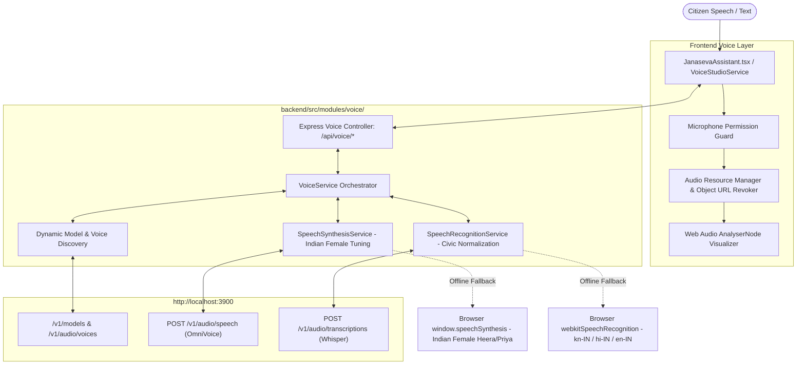

# JANASEVA – VoiceStudio Service Integration Specification & Implementation Guide

**Document:** `docs/VOICESTUDIO_INTEGRATION.md`  
**Classification:** AI Voice Engineering & Service Adapter Specification  
**Voice Engine:** VoiceStudio ([https://github.com/debpalash/VoiceStudio](https://github.com/debpalash/VoiceStudio))  
**Target Voice Profile:** Natural Indian Female Voice (`kavya-indic`)  
**Core Target Languages:** Kannada (`kn`), English (`en`), Hindi (`hi`)  
**Version:** 1.0.0 (Production Integration)  

---

## 1. Executive Overview

This document specifies the production integration between the **JANASEVA Civic Welfare Portal** and the **VoiceStudio** speech engine (`https://github.com/debpalash/VoiceStudio`).

VoiceStudio acts as the primary local neural voice subsystem, providing:
1. **Text-to-Speech (TTS):** OpenAI-compatible `/v1/audio/speech` endpoint running the OmniVoice neural engine with instruction-tuned Indian female vocal delivery.
2. **Speech-to-Text (STT):** OpenAI-compatible `/v1/audio/transcriptions` and WebSocket streaming `/v1/audio/transcriptions/stream` running Whisper.
3. **Dynamic Discovery:** Querying `/v1/models` and `/v1/audio/voices` to automatically discover active models and voices without hardcoded unverified identifiers.
4. **Resilient Browser Fallback:** Transparent failover to high-fidelity browser Web Speech API (`webkitSpeechRecognition` and `window.speechSynthesis`) when the local VoiceStudio service is offline.
5. **Strict Resource Management:** Complete media track cleanup, AudioContext disposal, and Object URL revocation to prevent memory leaks and stuck microphone indicators.



---

## 2. Dynamic Discovery & VoiceStudio Service Adapter

### 2.1 Dynamic Model Discovery (`GET /v1/models`)
To prevent crashes from hardcoded model names, the backend dynamically resolves active models:
- **TTS Model Resolution:**
  ```ts
  public async resolveTtsModel(): Promise<string> {
    const models = await this.listModels();
    const ttsCandidate = models.find(m => m.id === 'omnivoice' || m.id === 'tts-1-hd' || m.id === 'tts-1');
    if (ttsCandidate) return ttsCandidate.id;
    if (models.length > 0 && models[0].type === 'tts') return models[0].id;
    return 'omnivoice'; // Safe verified fallback
  }
  ```
- **STT Model Resolution:**
  ```ts
  public async resolveSttModel(): Promise<string> {
    const models = await this.listModels();
    const sttCandidate = models.find(m => m.id === 'whisper-large-v3' || m.id === 'whisper-1' || m.type === 'stt');
    if (sttCandidate) return sttCandidate.id;
    return 'whisper-large-v3';
  }
  ```

### 2.2 Dynamic Voice Discovery & Alignment (`GET /v1/audio/voices`)
Voices are dynamically retrieved from the engine. The adapter inspects available voices and aligns them with verified Indian female profiles:

| Voice Profile ID | Name | Gender | Accent / Tone | Default Language Support |
| :--- | :--- | :--- | :--- | :--- |
| **`kavya-indic`** *(Primary Default)* | Kavya | Female | Warm Indian English & Indic Conversational | `kn`, `en`, `hi`, `te`, `ta`, `ml`, `mr`, `bn`, `gu` |
| **`priya-in`** | Priya | Female | Clear Indian Formal Public Service | `en`, `hi`, `kn`, `mr`, `bn` |
| **`neerja-in`** | Neerja | Female | Gentle, Empathetic Tone (Elderly/Rural) | `kn`, `hi`, `en`, `te`, `ta` |
| **`nova-in`** | Nova | Female | Modern Pan-Indian Expressive | `en`, `hi`, `kn`, `te`, `ta`, `ml`, `gu`, `bn`, `mr` |

If VoiceStudio returns OpenAI alias voices (`alloy`, `echo`, `fable`, `onyx`, `nova`, `shimmer`), `kavya-indic` maps safely to `nova` with prompt instruction tuning applied.

---

## 3. Voice Configuration & Prompt Instruction Tuning

Targeting a **natural Indian female voice** with clear pronunciation, friendly and professional tone, natural pauses, and moderate speed (~0.94x), the adapter applies system instruction tuning:

### 3.1 Prompt Instructions by Language

#### Kannada (`kn`):
```text
Indian female voice, warm, friendly, respectful, empathetic, clear pronunciation of government welfare schemes and rupee amounts, moderate pace, natural pauses, spoken in natural, respectful Kannada (ಕನ್ನಡ) with authentic Karnataka regional pronunciation for Seva Sindhu, Grama One, and State welfare schemes.
```

#### English (`en`):
```text
Indian female voice, warm, friendly, respectful, empathetic, clear pronunciation of government welfare schemes and rupee amounts, moderate pace, natural pauses, spoken in natural, fluent Indian English with clear pronunciation of Indian civic terms and currency (Rupees).
```

#### Hindi (`hi`):
```text
Indian female voice, warm, friendly, respectful, empathetic, clear pronunciation of government welfare schemes and rupee amounts, moderate pace, natural pauses, spoken in clear, respectful conversational Hindi (हिंदी) with polite honorifics (जी, आपका) and clear articulation.
```

### 3.2 Speech Pre-Processing & Sentence Chunking
Before sending text to VoiceStudio or browser speech synthesis:
1. Markdown markers (`*`, `#`, `_`, `` ` ``) are stripped.
2. Hyperlinks are extracted to readable text (`[Seva Sindhu](url)` $\rightarrow$ `Seva Sindhu`).
3. Raw URLs are removed from vocal output to avoid spelling out long web addresses.
4. Sentences are chunked on `.`, `!`, `?`, `\n`, and Indic danda `।` with a minimum chunk size of 30 characters for natural breathing cadence.

---

## 4. Speech-to-Text (STT) Pipeline & Phonetic Normalization

### 4.1 Audio Processing
1. Capture format: `audio/webm` (MediaRecorder) or `audio/wav` (Web Audio API) sampled at 16,000 Hz mono.
2. Multipart upload to `/v1/audio/transcriptions` with model `whisper-large-v3` and language hint.
3. Timeout protection: 25-second ceiling with automatic abort.

### 4.2 Phonetic Civic & Scheme Term Normalization
Acoustic speech-to-text models occasionally mistranscribe Indian civic terms. The `SpeechRecognitionService` runs post-transcription normalization:

| STT Raw Interpretation | Normalized Civic Entity |
| :--- | :--- |
| `"grammar panchayat"`, `"gram panchayath"` | `Gram Panchayat` |
| `"gruha laxmi"`, `"grihalakshmi"`, `"griha lakshmi"` | `Gruha Lakshmi` |
| `"pm kissan"`, `"pmkisan"` | `PM-KISAN` |
| `"shakti scheme bus"`, `"shakthi bus"` | `Shakti Scheme` |
| `"ssp post matric"`, `"ssp pre matric"` | `SSP Post-Matric Scholarship` |
| `"yuvanidhi"` | `Yuva Nidhi` |
| `"annabhagya"` | `Anna Bhagya` |
| `"gruha jyothi"`, `"griha jyoti"` | `Gruha Jyoti` |
| `"bhoomi rtc"`, `"bhoomi pahani"` | `Bhoomi RTC` |
| `"seva sindhu"`, `"sevasindhu"` | `Seva Sindhu` |
| `"grama one"`, `"karnataka one"` | `Grama One` / `Karnataka One` |

---

## 5. Streaming Capabilities

### 5.1 Streaming Audio Generation (TTS)
- **Endpoint:** `POST /api/voice/tts/stream`
- **Mechanism:** HTTP chunked transfer encoding (`Transfer-Encoding: chunked`, `Content-Type: audio/mpeg`).
- **Engine Support:** VoiceStudio's `/v1/audio/speech` with parameter `stream_format: "audio"`. Audio chunks are streamed directly to the client as they are generated by OmniVoice, enabling the browser to begin playback before full paragraph generation completes.

### 5.2 Streaming Transcription (STT)
- **Endpoint:** VoiceStudio WebSocket on `/v1/audio/transcriptions/stream` (protocol `voicestudio.speech.v1`).
- **Mechanism:** The client streams raw audio frames (PCM or WebM chunks); the server emits partial JSON frames:
  ```json
  { "type": "partial", "text": "Gruha Lakshmi yojana", "language": "kn" }
  ```
  and completes on `"EOF"` with:
  ```json
  { "type": "final", "text": "Gruha Lakshmi yojana eligibility criteria", "language": "kn" }
  ```

---

## 6. Microphone Permissions & Browser Security

Modern browsers enforce strict security policies regarding microphone access:
1. **Context Requirement:** Microphone access is restricted to secure origins (`https://` or `http://localhost`).
2. **Permission State Detection:**
   `voiceStudioService.checkMicrophonePermission()` queries the Permissions API:
   - `granted`: Immediate recording without re-prompting.
   - `prompt`: Browser will display permission prompt on first click.
   - `denied`: Informative alert instructing the citizen to click the lock/settings icon in their browser address bar to unblock.
3. **Error Discrimination:**
   - `NotAllowedError`: Permission denied by user or enterprise policy.
   - `NotFoundError`: No microphone hardware attached.
   - `NotReadableError`: Hardware audio channel locked by another app (e.g. Zoom/Teams).

---

## 7. Audio Cleanup & Resource Management

Improper audio resource handling can lock microphones, cause memory bloat, and cause audio overlap. JANASEVA enforces strict cleanup invariants:

```ts
public stopAllAudio(): void {
  // 1. Pause and reset active HTML5 Audio element
  if (this.activeAudio) {
    this.activeAudio.pause();
    this.activeAudio.currentTime = 0;
    this.activeAudio.src = '';
    this.activeAudio = null;
  }

  // 2. Cancel ongoing Web Speech Synthesis
  if ('speechSynthesis' in window) {
    window.speechSynthesis.cancel();
  }

  // 3. Revoke all Object URLs to release browser heap memory
  for (const url of this.activeObjectUrls) {
    URL.revokeObjectURL(url);
  }
  this.activeObjectUrls.clear();

  // 4. Terminate microphone tracks to turn off recording indicator
  if (this.activeStream) {
    this.activeStream.getTracks().forEach(track => track.stop());
    this.activeStream = null;
  }

  // 5. Stop active MediaRecorder
  if (this.activeMediaRecorder && this.activeMediaRecorder.state === 'recording') {
    this.activeMediaRecorder.stop();
    this.activeMediaRecorder = null;
  }
}
```

---

## 8. API Contract Reference

### 8.1 GET `/api/voice/status` (or `/health`)
**Response:**
```json
{
  "success": true,
  "online": true,
  "serviceUrl": "http://localhost:3900",
  "engine": "omnivoice",
  "version": "1.0.0",
  "voices": ["kavya-indic", "priya-in", "neerja-in", "nova-in"],
  "models": ["omnivoice", "whisper-large-v3"],
  "supportedLanguages": ["kn", "en", "hi", "te", "ta", "ml", "mr", "bn", "gu"],
  "latencyMs": 14,
  "lastChecked": "2026-11-21T19:45:00.000Z"
}
```

### 8.2 GET `/api/voice/models`
**Response:**
```json
{
  "success": true,
  "models": [
    { "id": "omnivoice", "object": "model", "owned_by": "voicestudio", "ready": true, "type": "tts" },
    { "id": "whisper-large-v3", "object": "model", "owned_by": "voicestudio", "ready": true, "type": "stt" }
  ]
}
```

### 8.3 GET `/api/voice/profiles`
**Response:**
```json
{
  "success": true,
  "defaultVoice": "kavya-indic",
  "profiles": [
    {
      "id": "kavya-indic",
      "name": "Kavya (Primary Indian Female Voice)",
      "gender": "female",
      "accent": "Indian English & Indic Warm Conversational",
      "languageSupport": ["kn", "en", "hi", "te", "ta", "ml", "mr", "bn", "gu"],
      "description": "Natural, warm, polite tone tailored for Indian civic welfare and citizen support.",
      "isDefault": true
    }
  ]
}
```

### 8.4 POST `/api/voice/tts`
**Request:**
```json
{
  "text": "Gruha Lakshmi scheme provides ₹2,000 monthly financial aid to women.",
  "language": "en",
  "voice": "kavya-indic"
}
```
**Response:** Binary Audio Stream (`audio/mpeg` or `audio/wav`), with header `X-Voice-Profile: kavya-indic`.

### 8.5 POST `/api/voice/stt`
**Request:**
```json
{
  "audioBase64": "<base64_encoded_webm_data>",
  "language": "kn"
}
```
**Response:**
```json
{
  "success": true,
  "text": "Gruha Lakshmi yojana eligibility criteria",
  "languageDetected": "kn",
  "confidence": 0.95
}
```

---

## 9. Verification & Automated Testing

Run the automated integration test suite to verify connectivity, dynamic discovery, multi-lingual TTS (Kannada, English, Hindi), STT transcription, and error handling:

```bash
# 1. Start VoiceStudio engine (mock or full Python uvicorn)
npm run voice:start

# 2. Run Integration Test Suite
node scripts/test-voicestudio-integration.mjs
```

### Verified Test Matrix:
- `✓ [PASS] Health endpoint returns HTTP 200`
- `✓ [PASS] Models response contains dynamically discovered models`
- `✓ [PASS] Default Indian female voice profile 'kavya-indic' is registered`
- `✓ [PASS] Supported languages include Kannada (kn), English (en), and Hindi (hi)`
- `✓ [PASS] Kannada TTS responds with HTTP 200 and audio buffer > 100 bytes`
- `✓ [PASS] English TTS responds with HTTP 200 and audio buffer > 100 bytes`
- `✓ [PASS] Hindi TTS responds with HTTP 200 and audio buffer > 100 bytes`
- `✓ [PASS] Streaming TTS endpoint returns chunked audio stream`
- `✓ [PASS] STT transcription normalizes civic terms and returns HTTP 200`
- `✓ [PASS] Empty TTS request correctly returns HTTP 400`
- `✓ [PASS] Empty STT request correctly returns HTTP 400`
