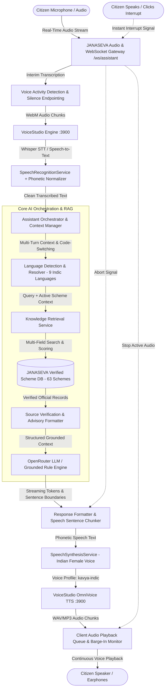

# JANASEVA – Production-Level Conversational AI Voice Assistant Architecture
**Document:** `docs/VOICE_ASSISTANT_ARCHITECTURE.md`  
**Version:** 2.0.0 (Production)  
**Classification:** Core System Architecture Specification  
**Authors:** Senior AI Engineer, Voice AI Architect, Full-Stack Developer  

---

## 1. Executive Architectural Overview

The JANASEVA Conversational AI Voice Assistant is an advanced, multilingual, human-like voice interaction platform engineered specifically for Indian citizen welfare services. It empowers citizens—regardless of literacy level, region, or dialect—to converse naturally in their preferred native language, ask follow-up questions without repeating scheme names, receive grounded government scheme information, interrupt the assistant at any time, and hear clear responses delivered in a warm, respectful, high-quality Indian female voice.

---

## 2. Component Architecture & Module Breakdown

The backend architecture strictly separates speech processing, knowledge retrieval, conversation lifecycle, and AI orchestration into dedicated, decoupled modules:

### 2.1 Knowledge Retrieval Module (`backend/src/modules/knowledge/`)
* **`scheme-retrieval.service.ts`**: Implements multi-field relevance scoring across `name`, `name_kn`, `name_hi`, `description`, `benefits`, `eligibilityCriteria.rules`, and `requiredDocuments`. Supports multilingual phonetic aliases (e.g., mapping `"ಗೃಹ ಲಕ್ಷ್ಮಿ"`, `"griha lakshmi"`, and `"women 2000"` to `gruha-lakshmi-yojana`).
* **`source-verification.service.ts`**: Formats verified source citations and enforces statutory advisory boundaries (DPDP Act § 12). Appends official application URLs and reminds citizens that registrations on portals like Seva Sindhu or PM-KISAN are 100% free with no private agent fees.
* **`knowledge.service.ts`**: Coordinates RAG retrieval to construct concise, grounded context payloads for the LLM.

### 2.2 Speech Processing Module (`backend/src/modules/voice/`)
* **`voicestudio.client.ts`**: Dedicated HTTP and WebSocket client communicating with VoiceStudio on `http://localhost:3900`. Discovers models via `GET /v1/models`, voices via `GET /v1/audio/voices`, handles timeouts, and caches health status.
* **`speech-recognition.service.ts`**: Performs speech-to-text with Whisper STT and executes phonetic replacement rules for civic terminology (e.g., correcting *"grammar panchayat"* to *"Gram Panchayat"*, *"griha laxmi"* to *"Gruha Lakshmi"*, and *"bhoomi rtc"* to *"Bhoomi RTC"*).
* **`speech-synthesis.service.ts`**: Dedicated Indian female voice orchestrator (`kavya-indic`, `priya-in`, `neerja-in`, `nova-in`). Splits long text into natural sentence chunks (minimum 25 characters, bounded by `.`, `!`, `?`, or Indic danda `।`) so synthesis and playback begin before the complete generation finishes.
* **`voice-stream.gateway.ts`**: Real-time bidirectional WebSocket gateway (`ws://<host>:<port>/ws/assistant`) managing client audio streams, sentence delivery, and instant barge-in cancellation.

### 2.3 Assistant Orchestration Module (`backend/src/modules/assistant/`)
* **`context-manager.service.ts`**: Tracks multi-turn dialogue history. When a citizen asks an elliptic follow-up query (e.g., *"Who is eligible?"* or *"What documents do I need?"*), it automatically extracts the active scheme from previous turns and injects it into the RAG query.
* **`response-formatter.service.ts`**: Cleans markdown symbols, bullets, and URLs, and converts numbers and currency (e.g., `"₹2,000"` to `"2000 ರೂಪಾಯಿಗಳು"` in Kannada or `"2000 rupees"` in English) into natural phonetic speech text.
* **`conversation.service.ts`**: Manages persistent conversation sessions in `janaseva_db.json`, enforcing tenant ownership checks so citizens only access their own conversation records.
* **`assistant.service.ts`**: Coordinates the entire RAG pipeline with OpenRouter models (`nvidia/nemotron-3.5-lightning:free` or `openrouter/auto`) and provides an offline deterministic rule-based fallback when external AI providers are unavailable.

---

## 3. Dedicated Indian Female Voice Configuration

The voice experience is configured to sound warm, empathetic, respectful, and articulate:

| Voice Profile | Gender | Target Delivery & Accent | Supported Languages | Purpose |
| :--- | :--- | :--- | :--- | :--- |
| **`kavya-indic`** *(Primary Default)* | Female | Warm, conversational, respectful Indian tone; natural pauses; clear numbers | Kannada, English, Hindi, Telugu, Tamil, Malayalam, Marathi, Bengali, Gujarati | Flagship conversational voice for general citizen inquiries |
| **`priya-in`** | Female | Clear, formal, articulate administrative accent | English, Hindi, Kannada, Marathi | Procedural documentation & application instructions |
| **`neerja-in`** | Female | Patient, gentle, encouraging elder-sisterly tone | Kannada, Hindi, Telugu, Tamil, English | Elderly citizens, pension inquiries, and rural beneficiaries |
| **`nova-in`** | Female | Modern, dynamic pan-Indian expressive delivery | English, Hindi, Kannada | Urban youth, scholarships, and startup loans |

---

## 4. Supported Languages & Code-Switching Architecture

The assistant supports 9 major Indian languages with automatic unicode script detection, phonetic transliteration parsing, and seamless bilingual code-switching:

1. **Kannada (ಕನ್ನಡ)**: Primary state language for Karnataka schemes (Gruha Lakshmi, Shakti, Anna Bhagya, Yuva Nidhi, Gruha Jyoti).
2. **Indian English (English - IN)**: Clear, neutral Indian English accent with accurate pronunciation of Indian names and rupees.
3. **Hindi (हिंदी)**: Devanagari script and conversational Hindustani for Central schemes (PM-KISAN, Ayushman Bharat, Mudra).
4. **Telugu (తెలుగు)**: Fluent Andhra/Telangana regional phrasing.
5. **Tamil (தமிழ்)**: Respectful, clear Tamil script phrasing.
6. **Malayalam (മലയാളം)**: Authentic Kerala regional diction.
7. **Marathi (मराठी)**: Devanagari script with Marathi civic terminology.
8. **Bengali (বাংলা)**: Natural Bengali script phrasing.
9. **Gujarati (ગુજરાતી)**: Clear Gujarati script delivery.

### Code-Switching Engine
Citizens frequently mix languages (e.g., *"Gruha Lakshmi ge yaru eligible?"* or *"PM-KISAN ka status kaise check karein?"*). The system handles this through:
- Script and lexicon hybrid detection.
- Contextual intent extraction regardless of English words mixed into Indic queries.
- Consistent response generation in the citizen's predominant vernacular language.

---

## 5. Real-Time Interaction, Streaming & Barge-In (Interruption)

To deliver a conversational experience comparable to ChatGPT Voice, the interaction pipeline avoids monolithic request-response cycles:

1. **Microphone Capture**: The browser captures audio using `AudioContext` and `AnalyserNode` at 16kHz mono.
2. **Streaming Speech Recognition**: Continuous speech endpointing triggers as soon as 2.2 seconds of silence are detected.
3. **Sentence-Level Concurrent Synthesis**: Rather than waiting 5 seconds for a full 200-word response, the assistant breaks text into sentences and feeds Sentence 1 immediately to VoiceStudio TTS.
4. **Time-to-First-Audio (TTFA)**: Audio playback begins while subsequent sentences are being generated in the background.
5. **Instant Barge-In (Interruption)**:
   - When the citizen speaks or taps Interrupt, an abort signal immediately cancels downstream TTS jobs.
   - Active HTML5 audio playback is stopped (`audio.pause(); audio.currentTime = 0;`).
   - The microphone is re-armed to capture the new utterance with conversation context intact.

---

## 6. Security, Privacy & Remote Deployment Hardening

1. **Zero Client Credentials**: VoiceStudio runs on a private loopback or private subnet (`http://localhost:3900`). The client browser never receives VoiceStudio credentials or backend API keys.
2. **Authentication & Ownership**: Conversation sessions are bound to `req.user.id`. Client-supplied user IDs are ignored; ownership is extracted strictly from verified JWT tokens.
3. **DPDP Act 2023 Compliance**: Citizens have the statutory right to erase their conversation history (`DELETE /api/v1/assistant/conversations/:id` or full account deletion cascade).
4. **Rate Limiting**: Express rate limiting protects endpoints against denial-of-service scrapers (120 requests/minute per IP).
